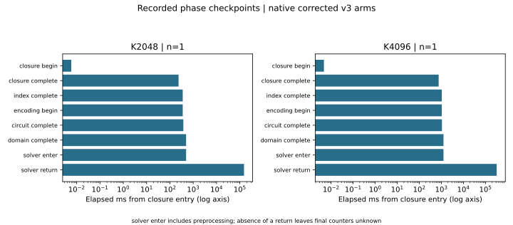
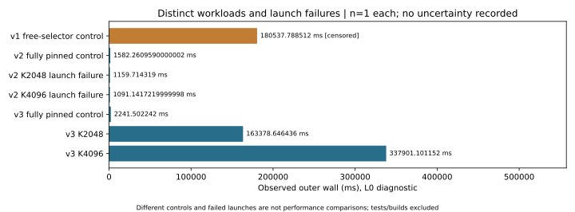
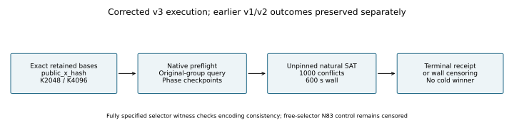

# Native N83 retained-base continuation, 19 October 2026

The approved historical raw evidence ZIP is published and verified in
`setec-astronomy-artifacts`: 5,771,044 bytes, 224 entries, SHA256
`b7afa24e3ca80630344b5e584915227c5e177c66068f6f5749ce72ba4894ba92`.
The [publication addendum](../../verification/raw-approved-publication-20261019/RESULT.md)
supersedes its older pending-upload state without rewriting frozen history.

This round adds an entirely native Rust execution/audit path and flushed
phase/query markers. The native strict card subset binds exact source,
runner, worker, inputs and command/output hashes. Independent polynomial-word
GF(2^83) arithmetic replays public query coefficients and points. Unsupported
positive relations/scalars are rejected pending a full native matrix verifier.
This is a bounded diagnostic, not completion of the full factor-base grid.

The public primary a=0 Koblitz fixtures use GF(2^83), modulus
x^83+x^45+x^2+x+1, subgroup order 2417851639230796216685689.
Both exact retained signed-Frobenius bases use public_x_hash, seed 2026100801.
Each natural arm is one m5 orbit-chain-S3 trial, unpinned selectors, at most
32 models,150000 variables,2000000 domain clauses,1000 conflicts and600s.
Docker uses an immutable image,1CPU,4GiB,no swap,network none,64PIDs,
read-only inputs/root,task UID,capabilities dropped,no-new-privileges and an
independent in-container hard timeout. Live/final inspections and cleanup are
retained. These are L0 diagnostic process/phase clocks; no A/A interval or
performance isolation tier is established. Build/test activity also ran on
the host. No throughput ratio or full cold runtime is inferred.

## Preserved control and configuration failures

V1's small-field original-group m5/m6 ordered/unordered controls passed with
four SAT returns. Its N83 fixed-coordinate/free-selector positive control
reached fixed_units_installed at 113.114676 ms, then was censored at
180537.788512 ms outer wall. No terminal counters are available. The positive
gate was not met; the original natural cards were never launched.

V2 explicitly changed the control predicate: coordinates, representatives
and Frobenius phases were all fixed, retaining full1182/866 domains. It
returned a verified SAT model with 0 conflicts, independently replayed group
sum, selector indices and phases. This checks encoding consistency only;
it does not resolve the N83 free-selector witness-search gap. A copied
record with phase+1 and coherently updated stdout custody was rejected:
`independent selector/phase replay mismatch`.

Both separately frozen v2 natural cards failed before search because the
runner requested public_x_sequential from public_x_hash manifests. Worker
exit1, no phase/query result, and successful cleanup are retained. V3
corrects that policy and adds a preflight rejecting wrong/ambiguous rows;
these are explicit new runs, not erased failures or automatic retries.
V3 repeats the positive controls with the newly pinned native runner.

## Evidence and validation

Protocols and compact evidence live beside this report under
[verification/native-phase-20261019-v3](../../verification/native-phase-20261019-v3/).
V1 source is fc7d1a63f75add58b9eb619cad93c730d5b047c0;
v2 source is c259497ec9cf1fde358ffc91eabe8c2cff242f95;
v3 source is 27d17bd17b9fe9c6b4ce04e0c9206706b2b5c804.
Earlier runner/worker binaries and source snapshots remain available; no
Python research supervisor/auditor/test was executed in this continuation.

Fresh full release validation exited 0: 4397 library tests passed,118 ignored;
19 exporter tests passed; fixed-witness example 0 tests. The new selector
locator test passed, as did 13 native runner/card tests. The historical sealed
compact catalog's 92 files re-hashed unchanged. Validation logs and exact
commands are included in the evidence bundle. Figure data copies recorded
values only; closure-relative phase clocks and process outer clocks are
separate, with n=1 and no recorded uncertainty interval.

Canonical graphs checked and unchanged: docs/ic-leaderboard.html,
docs/index-calculus-scoreboard.html,docs/ic/progress-timeline.json.
No qualified pipeline gain, external comparison, matched rho comparison or
complete cold winner is established. Missing final counters are unknown,
never zero. Censoring does not establish UNSAT or absent decompositions.
The full finite-grid sweep, useful natural rank, column logs, individual-log
work and native positive-relation/matrix replay remain open.

## Corrected natural-arm outcomes

| Arm | Native audit | Outer wall (ms, measured) | Conflicts | Models / relations / rank |
|---|---|---:|---:|---|
| K2048 | PASS_NATIVE_BOUNDED_ZERO_RELATION_REPLAY | 163378.646436 | 1000 | 0 / 0 / 0 |
| K4096 | PASS_NATIVE_BOUNDED_ZERO_RELATION_REPLAY | 337901.101152 | 1000 | 0 / 0 / 0 |

Both complete within 600 s, use the same independently replayed public query,
and have verified cleanup. K2048 reaches solver_enter at494.522973ms and
solver_return at150836.78276ms; K4096 at1246.270244ms and321957.343926ms,
respectively, all relative to their own closure entry. The call includes
preprocessing; its internal cost split remains unknown. This resolves the
[bounded terminal observability issue](../../../../problems/n83-native-k4096-terminal-observability.md).
The [free-selector known-witness search](../../../../problems/n83-free-selector-known-witness-search.md)
remains open. These n=1, L0 observations do not establish a speed ratio, natural
yield estimate or full cold winner. No solver process remains running after
these bounded cards; the next diagnostic is not scheduled by this report.

The new native raw archive is preserved locally (49,012,484 bytes,
SHA256 bef8a03c355b2238282638e326dd571bd91dd6873f5ed1df5fe12db2f0dcd5c3).
Its [content manifest and exact storage plan](../../verification/native-phase-20261019-v3/raw-artifact-plan.json)
are reviewable. Automatic approval review rejected its upload as outside the
approval for the earlier exact ZIP; no new archive upload occurred. The
[earlier approved ZIP](../../verification/raw-approved-publication-20261019/RESULT.md)
remains uploaded and verified. Final integration tests are documented in the
[separate integration addendum](../../verification/native-phase-20261019-v3/INTEGRATION.md).

Supplemental [host metadata](../../verification/native-phase-20261019-v3/host-cpu.json)
observed after the runs identifies Intel Xeon 6975P-C, x86_64, 32 logical CPUs;
this does not establish exclusive-core isolation.
