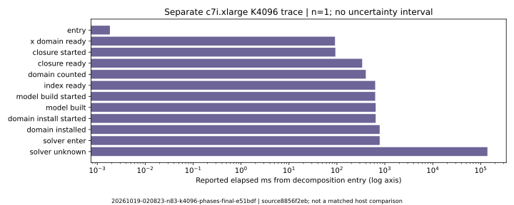
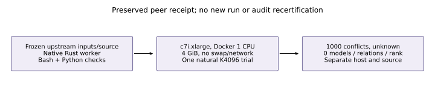

# Separate upstream K4096 native-worker diagnostic

This report renders the existing [upstream receipt](../../verification/k4096-native-phases-20261018/RESULT.md)
merged from 02792dec6; it is not a new run or independent rerun by the new
native Rust harness. Frozen worker source is
8856f2eb36e1aa132af2c0c20c9d422789ab0774; job ID is
`20261019-020823-n83-k4096-phases-final-e51bdf`, on c7i.xlarge.
Native Rust worker, Bash orchestration and separate Python audits/tests are
preserved as provenance. No Python cryptographic replay was run to render
this report; the renderer only plots recorded trace values.

The exact public primary a=0 N83 Koblitz fixture and retained K4096 base use
m5 orbit-phase chained S3, one public trial, a 1,000-conflict/600-second cap,
32-model maximum, 150000 variables/2000000 domain clauses. Docker limits were
1 CPU, 4 GiB, no swap, no network. Native wall is L0 diagnostic, n=1 with no A/A
or uncertainty interval. Full host configuration, source/input/binary hashes,
resource/cleanup records and raw archive locations are in the linked result.

Reported outcome: UNKNOWN_solver_cap at 1,000 conflicts; 0 models, 0 relations,
rank 0. Installed model: 131958 variables, 2021197 clauses, 4980 XORs.
Model ready at 780.945 ms and solver return at 138237.881 ms relative to
entry; the original receipt reports 137.457 s inside the solver. Worker
pre-summary wall is 148.223 s, with 751669248 bytes cgroup peak. Runner elapsed
covers checkout, build and setup and is a separate interval, not a one-CPU
solver measurement. All values here are reported from frozen upstream
records; there is no new research computation, speedup or derived ratio.

A local Bash 3.2 preflight failure, a paid input-access failure and a paid
missing-sidecar failure are preserved in [launch records](../../verification/k4096-native-phases-20261018/launch/).
They provide no solver or relation outcomes. The final job completed and
its instance terminated. Reported phase/query and completed-run audits and
four mutation rejections remain under the original directory; their Python
provenance is preserved and is not labeled as execution by the new native
harness. This report does not recertify that audit implementation.

This source/host differs from the [matched native K2048/K4096 round](../run-20261019T0140Z/REPORT.md).
Do not combine their times, counters or validation into a matched speed
comparison. No natural-yield estimate, fastest base, useful rank or complete
cold winner is established. The canonical leaderboard, scoreboard and
progress timeline remain unchanged. Editable data/source, SVG/150dpi PNG
and the inspected PDF accompany this report; benchmark copies are separate.
