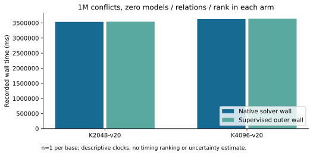
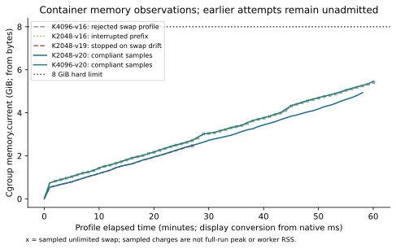
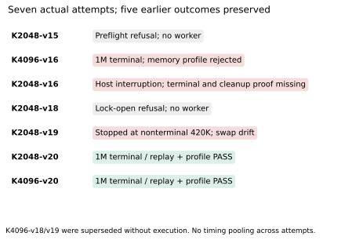

# Native N83 sweep through 1M conflicts

Campaign began 2026-10-20 UTC; replacement-host continuation completed 2026-10-21 UTC.
Both K2048-v20 and K4096-v20 completed **1000000 conflicts, zero models, relations and rank**.
Fresh native replay, memory-profile validation, exact card/relay assessment and cleanup pass.
These are bounded unknown results, not UNSAT or scalar recovery. No base is selected.

| completed arm (n=1 each) | native solver wall, ms | supervised outer wall, ms | command, seconds | memory samples | greatest sampled charge, bytes |
|:--|--:|--:|--:|--:|--:|
| K2048-v20 | 3535009.185143 | 3540895.977546 | 3552.809621051 | 59 | 5304934400 |
| K4096-v20 | 3627836.176575 | 3638645.773661 | 3648.855038327 | 61 | 5876035584 |

Native solver wall is `solver_return.elapsed_ms - solver_enter.elapsed_ms`, calculated
by the frozen Rust `summarize-xor` command. Outer and command intervals are recorded separately.
All samples retain memory.max8589934592 and memory.swap.max0. Greatest sampled kernel
memory.peak equals greatest sampled charge in each run. Neither is a full-run maximum:
last-sample-to-outer-end gaps are57001.402148ms and34479.901983ms respectively.
Sampling about once per60seconds cannot prove no drift between samples.

Clocks are descriptive, with no uncertainty estimate or timing ranking. Full core14/30
reserved, workerCPU14,1CPUquota,8GiB/no extra swap, strict quiet/thread/affinity gates,
networknone/read-only/capdropALL/no-new-privileges/64PIDs. No builds/tests/compression ran
inside measured arms. Fixed kernel threads and missing worker context-switch/fault counters
prevent automatic L2. Setup barriers are charged in outer time. Init RSS/HWM describes a
startup/timeout supervisor, not SAT-worker RSS. Allocation causes remain unmeasured.

## Every actual attempt

| actual attempt | observation and disposition | recorded command seconds |
|:--|:--|--:|
| K2048-v15 | CPU PSI preflight refusal; no worker, exit1; last avg10=34.59>5 | 39.349220755 |
| K4096-v16 | 1M terminal, zero models/relations/rank; historical replay PASS, later memory profile REJECTED: swap0,0,then"max" from120568.421691ms; not admitted under requested envelope | 3684.731943389 |
| K2048-v16 | old-host shutdown; no terminal/receipt/final inspection/verified cleanup; last observed53000conflicts nonterminal; retained5-sample prefix only | missing |
| K2048-v18 | opening existing benchmark lock refused; no worker, exit1 | 15.120572840 |
| K2048-v19 | stopped after28th sample records swap"max"; last snapshot420000conflicts nonterminal, exit1; failure inspect137/noOOM, cleanup verified; terminal models/relations/rank null | 1643.653593095 |
| K2048-v20 | 1M complete, exit0/noOOM/no wall censor, replay/profile/cleanup PASS | 3552.809621051 |
| K4096-v20 | 1M complete, exit0/noOOM/no wall censor, replay/profile/cleanup PASS | 3648.855038327 |

K4096-v18/v19 were never compiled/executed; no observation or actual cost is assigned.
The withdrawn K4096-v20 dispatch PATH typo was corrected before any command or relay;
the actual sole command matches the frozen prompt. No automatic timed retry occurred.
All original refusals, valid nonterminal traces, missing custody and rejected profiles
stay in evidence. Historical replay PASS never overrides a failed resource profile.
The conservative preregistered maximum is42000worker-seconds across these seven actual
commands, including full allocations for refusals; not a complete historical cold/campaign ledger.

## Infrastructure corrections and source

The existing benchmark lock is opened without O_CREAT, with race-safe creation only
when absent; exclusion and inode identity are retained. No lock ownership/mode/sysctl
changes were made by this task. Independent root foreign-owner/sticky-directory
regression and default-lock readiness passed. A peer later changed lock ownership;
the same inode1088 remained and both new native arms acquired it successfully.

Owned idle controls reproduce kernel swap0/systemdMemorySwapMax=infinity becoming
kernel"max" after a resource reapply. Setting only the owned unit's runtime property
to0 restores kernel0 and retains0 under reapply (recorded0,max,0,0). This reproduces
a mechanism, not the exact historical caller. Narrow filtered audit did not identify it.
Guard-v20 holds the worker at a shell startup barrier, verifies the owned Docker/PID/
cgroup, synchronizes its unit MemorySwapMax0, verifies hard memory/quota/cpuset/drop-in,
then writes a hash-bound RESOURCE_READY. Native replay checks both startup records.
After release any sampled drift stops the arm; there is no repair during execution.
Owned container/runtime file cleanup verifies. Peer units and daemon policy are untouched.

Frozen controller source66ab009b1d91792c46d078e15adfeda45eacf29f;
runner SHA256ecc418f20f276b44cf8ec61019cee09c36228d1c78e5c62f4512afb665451f67.
Worker unchanged SHA2563a31bd2bedee5519d30b517f39ec27f72561ce898213657688c55b51bbcdf7b6;
nine watched sources match660f0f4b10. Same image541096ae9b05d3b850341b78790e2ed31e94d5aa0ea086933c6ff0c09ffa2e63.
Replacement host ip-172-31-26-135.us-east-2.compute.internal, Xeon6975P-C/32logicalCPU;
old host ip-172-31-36-154.us-east-2.compute.internal was shut down mid-K2048-v16.
No pooling across hosts/resource envelopes.

Primary curve a=0 icv1-f2m83-tm6151469093347-debefd74, field x^83+x^45+x²+x+1,
subgroup2417851639230796216685689; retained public_x_hash seed2026100801,m5,
identitymask0,K2048/K4096panels and public fixtures. The positive-trace a=1 holdout
icv1-f2m83-t6151469093347-9eba6cd5 is distinct; no EC1 equivalence is promoted.
Each new arm:1Mconflicts/6000worker-seconds/6600command-seconds, strict unchanged gates.
Protocol/addenda remain frozen under [verification](../../verification/native-natural-1m-20261020/).

## Validation, custody and requirements

Fresh release tests:4409library pass,118ignored,19exporter pass,2model-checker pass.
Final guard30unit+7card tests pass, plus native startup/barrier/scope-reapply/cleanup
smoke and root lock regression. Both live observer streams are byte-identical to final
captured logs. Native audits recheck original group/query, sources/ELFs/inputs/streams,
terminal/phase records, startup/resource policy, exit/OOM, isolation and cleanup.
The native memory helper checks custody/counters and retains the failed older profiles.

| requirement | status and evidence |
|:--|:--|
| finish K2048/K4096 1M runs | verified; [completed records](../../verification/native-natural-1m-20261020/completed-v20/) |
| validate memory profiles | verified for both v20 runs; earlier rejects/prefix remain unadmitted; native JSON in data/ |
| retain/upload all raw evidence | immutable raw name and fresh-GET/payload/replay/repack receipts in [PUBLICATION.md](../../verification/native-natural-1m-20261020/PUBLICATION.md) |
| report and PR update | this report, inspected PDF and byte-identical benchmark copies; PR2036 |
| complete campaign cost / useful natural yield / end-to-end IC gain | unresolved; older terminal costs and matched complete solves absent |

Storage is restored on the replacement host. Original800K raw/sidecar and the initial
1M checkpoint were freshly verified. Pre-worker v20 checkpoint54769744bytes SHA256
dc52c9c6bd7e18b16fe0c0365efb79b21e9b06c008aa688eb95fcc72866b3026 is uploaded,
freshly downloaded, payload/native historical replay and negative/prefix checks pass,
and canonical repacking is byte-identical. Final full raw tree is published as
`store:evidence/n83/natural-1m-20261020/runs.tar.xz`; receipts and exact raw digest are
kept outside the archive to avoid recursive self-hashing. See publication for actual
storage status and repeatable commands; an archive does not contain proof of its own upload.

Graphs consume native JSON only. Python lays out figures/PDF; it calculates no research
result. SVG and150dpiPNG share one source; benchmark copies include every graph/PDF.
Canonical docs/ic-leaderboard.html, docs/index-calculus-scoreboard.html and
 docs/ic/progress-timeline.json were checked and left unchanged: their frozen component,
cold/rho and identity conclusions receive no eligible new promotion. This report adds
bounded-search/resource coverage. Existing CMS5.17.0 known-witness comparison remains
faster than native; no matched external full-natural solve or fastest-tool claim here.
No scaling, cold minimum runtime, rho speedup, allocation attribution or recovery claim.

Next discriminating work: profile SAT-worker allocations in a separately frozen control,
then compare a targeted memory/propagation change on identical checked inputs. A higher
conflict cap would be a new bounded search, not evidence of improved yield or complexity.
Broad PR CI/base reconciliation hold remains separate from these passed native checks.
