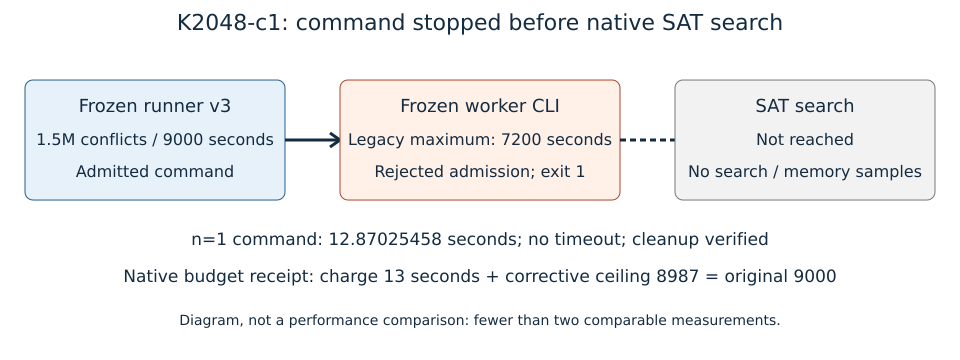

# K2048 continuation: admission failure and bounded correction

Run K2048-c1 began2026-10-23T04:44Z at source
`a591f1daa3f26628ac1dadb0561acd366ef61ca2`. Requested native public N83
orbit-chain workload: K2048, m5, public_x_hash seed2026100801, one target,
1.5M conflicts,9000worker seconds,8GiB/swap0,1CPU quota,core14/30 worker14,
original image/fixtures/panel. Command timeout10200,lock queue<=600 seconds.
See the frozen card/spec/raw source in the failure archive and
[the correction](../../verification/native-arena-reclamation-20261023/RESPEC-C2.md).

One command ran once; exit1, no timeout. Whole-command elapsed12.87025458seconds
is a diagnostic accounting interval (n=1,no uncertainty), not algorithm wall.
The worker rejected9000seconds at its old7200-second CLI gate before SAT;
stdout and memory-profile were empty, no run directory existed. The runner
then failed with “empty memory profile”. No solver result, relations, search
counters or algorithm memory samples exist. Docker OOM=false and both native
cleanup checks pass. Requested continuation status: **failed before search**.
The independent director verifies frozen argv/custody/relay and recommends
respecification; it makes no scientific claim. Precompile/dispatch pressure
and lock refusals remain raw evidence, separate from the one timed attempt.

Fewer than two comparable values exist, so this diagram replaces a comparative
graph. It illustrates the recorded gates only. Editable SVG is the figure source.
Whole-command duration and refusal classification come from the immutable relay,
outer/inspect and stderr records; the native receipt binds their BLAKE3 hashes:
[budget.json](../../verification/native-arena-reclamation-20261023/admission-correction/budget.json).
Native accounting derives ceil(12.87025458)=13seconds, leaving8987inside the
same9000slot; it grants zero new allowance. Four workloads including one corrective
attempt retain30000worker seconds. K4096 remains9000; unused time never transfers.

The narrow worker admission correction passes21exporter tests including the
actual CLI path; guard43tests and7card tests pass. Legacy admission and the
SAT/arena implementation remain unchanged. Full1Mmatched-prefix and later
storage validation are still required on the corrected continuations; they
have not run at this report's freeze. Prior accepted1Mresults and raw bytes
remain separate. No UNSAT, selected-base, memory minimum, speedup, fastest,
recovery or rho conclusion follows from this admission failure.

Canonical graphs checked and unchanged: docs/index-calculus-scoreboard.html,
docs/ic/progress-timeline.json, docs/ic-leaderboard.html and accepted1M
storage-growth/arena-partition/reclaimed-words figures. This failure adds no
eligible performance/leaderboard row. No external timing comparison applies
to a worker that did not enter the search. All-page PDF inspection is recorded
beside this report. Raw evidence goes to setec-astronomy-artifacts through
the tracked store manifest, including failed streams/source/cards/receipts.
