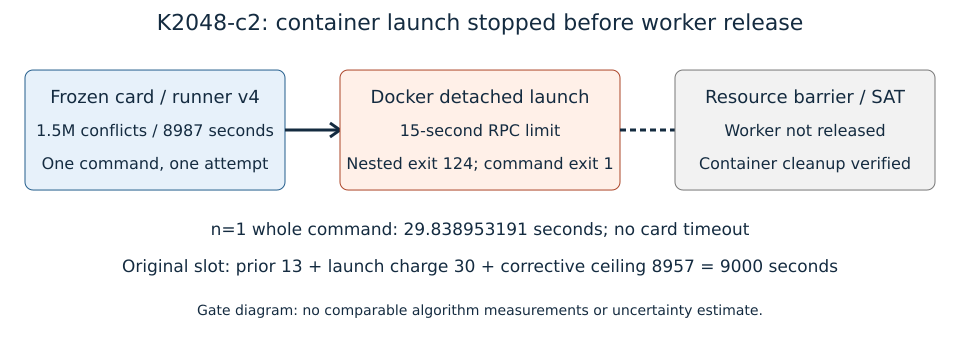

# K2048-c2: Docker launch failure before native worker release

The single corrected card at source
`de389b7ad4f6fb8a911a1e31d0c3d8ff0626d6c0` requested the same public N83
K2048 orbit-chain workload, m5, public_x_hash seed2026100801, one target,
1.5M conflicts /8987 worker seconds. Command ceiling10187, lock queue<=600,
8GiB/swap0, one CPU quota, reservation14/30,worker14, original pinned
image/panel/fixtures. Native admission tests had passed. Requested/completed:
one command attempted; **no worker search released or completed**.

Whole-command29.838953191seconds is recorded diagnostic accounting, n=1,
no uncertainty. Command exit1, no card timeout; the nested Docker detached-launch
RPC returned124 at its15-second limit. RESOURCE_READY was absent; no run
or memory-profile exists. Native container removal, cleanup and systemd runtime
cleanup pass. Director verifies exact argv, source, binds, receipt and verbatim
relay and classifies impeded launch. No search result is admitted. The separate
c1 admission failure and accepted1M arms remain unchanged.

Fewer than two comparable algorithm measurements exist, so the editable SVG
is a gate diagram. Algorithm time, conflicts, relations and memory observations
are missing. Native launch accounting derives ceil(29.838953191)=30seconds,
adds the earlier13-second charge, and leaves8957 in the original9000 slot.
See [native budget receipt](../../verification/native-arena-reclamation-20261023/launch-correction/budget.json),
[director assessment](../../verification/native-arena-reclamation-20261023/launch-correction/c2-director-assessment.json)
and [separate preregistered correction](../../verification/native-arena-reclamation-20261023/RESPEC-C3.md).
A native negative control with a release marker rejects budget creation.

Docker health subsequently reports25.0.16,overlay2,zero surviving containers.
I/O PSI was elevated during diagnosis; it is not a proved cause. No daemon
restart, peer stop or new EKS job occurred. Only the single Docker run RPC wait
changes15→60seconds inside the existing command ceiling, never retried.
Other mutation limits remain15; worker time and total30000 allowance do not
increase. Both CPU and I/O PSI some avg10<=5 are required before dispatch.

Correction validation passes21exporter,44runner and7native-card tests. A native
noncryptographic smoke test at the original image,8GiB/swap0 and core14 verifies
hold-before-release, scope synchronization, zero swap after resource reapply,
exit0 and cleanup. This is readiness evidence, not a cryptanalytic result.
The worker/runner admit only new K2048(1.5M,8957) and K4096(1.5M,9000)
continuations beyond their legacy limits. SAT/arena/library/dependencies are
unchanged. The corrected searches have not run at this report freeze.

Raw failure/card/spec/streams/source/binds/relay/receipt, both readiness probes,
source/build/test/accounting/smoke records go to setec-astronomy-artifacts
through store/index.json; see PUBLICATION.md. Canonical graphs checked and
unchanged: docs/index-calculus-scoreboard.html, docs/ic/progress-timeline.json,
docs/ic-leaderboard.html and the accepted1M storage/reclamation figures.
No eligible leaderboard/benchmark row, external speed comparison, UNSAT,
base winner, recovery, minimum-memory or rho conclusion follows from this failure.
