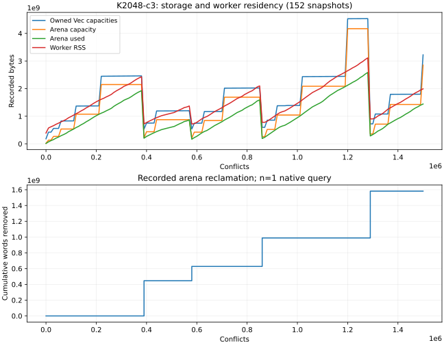

# K2048-c3: native 1.5M-conflict continuation

Completed one public N83 natural K2048 orbit-chain query at frozen source
`c13e33dccd9563f6c1a5d17ed88bd1783db7501b`, worker8ab6f9cf and guardefa7c805.
Original m5/public_x_hash/seed2026100801 inputs, one target, pinned image,
8GiB/swap0, one CPU quota, core14/30 worker14, lock queue<=600. Exact caps:
1500000conflicts/8957worker seconds/10157command seconds, under RESPEC-C3.md.
The earlier c1 admission and c2 launch failures remain separate raw evidence;
13+30seconds are charged in the same original9000slot. No automatic retry or
budget extension. Preliminary/postcompile pressure refusals and subsequent
clearance of the unchanged card are retained. The card ran once.

Native audit, memory custody, director argv/relay/receipt/binds/cleanup checks
pass. One command took5325.486226592seconds, exit0, no timeout. This is diagnostic
command accounting, not a matched algorithm-speed or cold-cost comparison.
The solver completed1500000conflicts, zero models/relations/rank and bounded
Unknown. All1001 retained original search signatures through1M match; later
search signatures are unpaired. All152 required storage snapshots validate.

n=1query, no uncertainty estimate. The graph plots native fields directly from
[data/reclamation.json](data/reclamation.json); capacities, logical usage,
allocator charges and RSS remain distinct. Four reclamations removed cumulative
1581835327arena words. At solve return: owned Vec capacities3224572539bytes,
arena capacity2852640992, logical arena used1442549336, worker RSS1990930432,
worker HWM3157737472. Memory limits/events and all sampling gaps/tails are recorded
separately in [data/memory.json](data/memory.json); sampled peaks are not asserted
as an exact full-run peak. No minimum-memory threshold is established.

Independent director assessment: [data/director-assessment.json](data/director-assessment.json).
Raw tree: verification/native-arena-reclamation-20261023/exec/k2048-c3,
with card and authoritative prompt under the campaign scratch cards directory;
the sealed S3 bundle includes them, every bind, source, logs, receipt, relay,
all refusals, native validators and report. PUBLICATION.md/store/index.json
record the immutable name/hash/receipts once sealed. No raw bytes were rewritten.

No useful relation, UNSAT, scalar recovery, selected factor base, speedup,
fastest implementation or rho gain follows. Historical hosts/clocks/RSS are
not pooled. K4096's1.5M continuation remains open at this report freeze.
Canonical graphs checked and unchanged: docs/ic-leaderboard.html,
docs/index-calculus-scoreboard.html, docs/ic/progress-timeline.json and the
accepted1M figures. This is a zero-relation diagnostic; no admitted leaderboard
or benchmarks/README row. Documentary SVG/150dpiPNG/PDF copies are retained
under benchmarks/20261023-n83-arena-reclamation. External speed comparison
not run: this run establishes counters/storage/custody, not a speed result.
