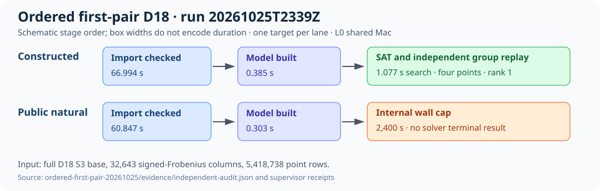

# Full-D18 ordered first-pair run

UTC start: 2026-10-25 23:39:52.524947. Curve: `icv1-f2m83-tm6151469093347-debefd74`. Source commit: `c2d39e4948ab3a9dbf2e67ad705476441c6a5d02`. Isolation: shared Apple M4 Pro, L0, one worker per arm, no hard memory cgroup. This report describes one constructed control and one public natural target under the frozen ordered-first-pair protocol. [Raw result and receipts](../../verification/d18-full-orbit-20261025/ordered-first-pair-20261025/RESULT.md) are the source of truth.

The exact full-D18 S3 generation has 32,643 signed-Frobenius columns representing 5,418,738 point rows; compressed object SHA-256 `eaef94ef45b3d2d4cd2ec2f40c1173b4cdb2a437b7e618a858c73fb1caf3902b`. The release example SHA-256 is `371b32ca7ebe1bacd679182b7ee0984b0d6697ae7ab74a1619896249c49a464b`. The frozen protocol, raw worker/supervisor records, independent audit, provider receipts and SHA inventory are in the [run evidence](../../verification/d18-full-orbit-20261025/ordered-first-pair-20261025/evidence/). Exact launches are the [positive command](../../verification/d18-full-orbit-20261025/ordered-first-pair-20261025/evidence/positive/command.json) and [natural command](../../verification/d18-full-orbit-20261025/ordered-first-pair-20261025/evidence/natural/command.json).

Both arms have n=1. Measured constructed-positive import was 66.994 s, model construction 0.385 s and search 1.077 s. It returned rows `[0,166,332,498]`, rank one, with an independently checked original-field group sum. Measured natural import was 60.847 s and model construction 0.303 s. The natural worker hit its 2,400 s wall cap and exited 124 after 2,401.126 s. Its audited status is `PASS_CENSORED_NATURAL`; solver result, counters and relation are missing.

These are one observation per arm; no spread or confidence interval is estimable. The [run diagram](diagram.svg) is schematic, not a time-scaled comparison. Natural maximum resident set was 4,401,053,696 bytes with zero recorded swaps. The positive replay rejected changed-target and changed-row-digest controls. The original supervisor summary incorrectly labeled the expected internal cap `PRODUCER_FAILURE`; the independent audit retains that summary and corrects the classification. The raw evidence was not rewritten.

This run does not measure natural relation yield or useful rank. Closure, factor-base logarithms, unseen-target descent, fully charged cold IC runtime and matched same-target rho remain unmeasured. `selected_best_total_runtime=null`. The next step is a resource-qualified native solver attempt with the exact frozen input and independent model/group replay, then the downstream gates in the [problem record](../../../../problems/n83-mixed-orbit-factor-base-selection.md). The canonical scoreboard and progress graphs were checked: there is no new complete or comparative result to plot there, so they remain unchanged.
