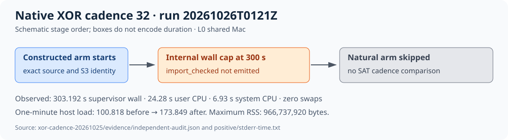

# Full-D18 native XOR cadence-32 capacity run

UTC start: 2026-10-26 01:21:11.982198. Curve: `icv1-f2m83-tm6151469093347-debefd74`. Source commit: `00b3d3929e493587676001e58c3d8bdcc67e3dc0`. Isolation: shared Apple M4 Pro, L0, no hard memory cgroup. This report describes one attempted constructed positive; the natural arm was skipped by the preregistered positive gate. [Raw result](../../verification/d18-full-orbit-20261025/xor-cadence-20261025/RESULT.md), [exact command](../../verification/d18-full-orbit-20261025/xor-cadence-20261025/evidence/positive/command.json), [independent audit](../../verification/d18-full-orbit-20261025/xor-cadence-20261025/evidence/independent-audit.json) and [evidence directory](../../verification/d18-full-orbit-20261025/xor-cadence-20261025/evidence/) are the source of truth.

The exact full-D18 S3 object is 160,747,529 bytes, SHA-256 `eaef94ef45b3d2d4cd2ec2f40c1173b4cdb2a437b7e618a858c73fb1caf3902b`; wrapper SHA-256 `1b93351febd47dac4de8c5dd39dbf58564d0057a044054baf448d978f6c0d616`. Fresh full-object provider checks verified both GETs. The release exporter SHA-256 is `d3ce79d87241ace0b5af50012e3237192972128c0e14dcc2a64224c66e128d14`.

The constructed positive attempted one model import and completed zero. Supervisor wall was 303.192 s, with 24.28 user and 6.93 system CPU seconds and maximum resident set 966,737,920 bytes. The internal 300 s cap ended `UNKNOWN_wall_cap` before `import_checked`. The public natural arm was skipped by the positive gate; its wall, CPU and memory measurements are missing.

The [run diagram](diagram.svg) shows the phase boundary. One-minute host load rose from 100.818 before to 173.849 after. No model, formula shape, solver counters or relation were emitted. These observations cannot compare cadence-1 and cadence-32 search time; there is one censored attempt and no distribution or interval. The historical supervisor label `POSITIVE_GATE_FAILED` is retained, while the independent audit classifies the attempt `CAPACITY_CENSORED_BEFORE_MODEL` and rejects an altered cap-status control. Native exhaustive mixed CNF/XOR differential checks passed 120 cases across cadences 1, 2, 4 and 32; the N83 full-input correctness gate remains pending.

Next: use a resource-qualified host with the exact S3 generation, native source and positive independent replay before launching the natural arm. The [problem record](../../../../problems/n83-mixed-orbit-factor-base-selection.md) tracks the remaining relation/rank/target/rho gates. `selected_best_total_runtime=null`. The canonical scoreboard and progress graphs were checked and left unchanged because this run supplies no complete or comparative cost point.
