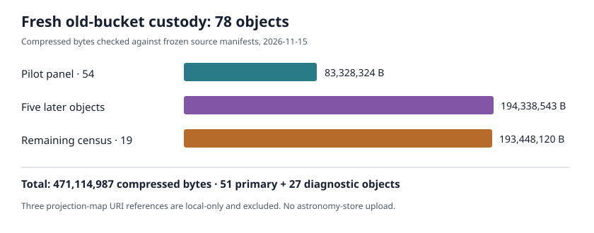

# N83 retained-object census completion, 2026-11-15

**Observed, local L0 custody audit.** The [October S3 manifest census](../../verification/live-s3-manifest-census-20261025/evidence-01/catalog.json) reconciled 77 content-addressed factor-base objects. The full D18 object added later is outside that census. Fresh `HeadObject` and `GetObject` checks, followed by source-bound native compressed and plain hashing, now cover those **78 existing old-bucket objects**. The audit records proposed astronomy-store keys but performs no new-bucket write and no index-calculus timing.

| Native inventory | Objects | Compressed bytes | Curve arms |
|:--|--:|--:|:--|
| [Original pilot](../../pilot-01/migration-inventory-native/INVENTORY_20261115.json) | 54 | 83,328,324 | 27 `a=0`, 27 `a=1` |
| [Five later objects](../../pilot-01/migration-inventory-native/INVENTORY_HISTORICAL_20261115.json) | 5 | 194,338,543 | `a=0` |
| [Remaining census objects](../../pilot-01/migration-inventory-native/INVENTORY_CENSUS_REMAINING_20261115.json) | 19 | 193,448,120 | `a=0` |
| **Freshly checked total** | **78** | **471,114,987** | 51 `a=0`, 27 `a=1` |

The 19 newly checked objects comprise one earlier direct-subgroup D18 (81,844,623 B), 16 standard-subspace objects (7,280,986 B), and two size-frontier objects (104,322,511 B). The [native census verifier](../../pilot-01/migration-inventory-native/src/bin/census_remaining.rs) reads the two predecessor inventories and the byte-identical archived [census manifest snapshots](../../pilot-01/migration-inventory-native/source-manifests/census-20261025/). It requires 77 distinct catalog keys, the frozen census index's SHA-256 and size for each selected source manifest, exact catalog/manifest URI and compressed identity, decompressed BLAKE3, and the earlier D18 exact-fetch receipt. The source manifest calls the earlier D18 export `EXPORTED_UNREPLAYED`; the census independently records a full-row replay. Neither label is converted into a cold end-to-end IC result here.

## Literal URI reconciliation

A study-wide scan found 81 unique old-bucket `.jsonl.gz` URI strings. Set comparison showed that the October 77-object catalog contains every literal URI except the later full D18 and three `standard-subspace/projection-map/` URIs. The full D18 returned a matching HEAD and passed the five-object audit. The three projection-map HEAD calls each returned **404** on 2026-11-15; their [source record](../../verification/standard-projection-map-20261015/local-prepared.json) says `PREPARED_LOCAL_ONLY`. They are retained as proposed-local URI references, not counted as stored objects. This reconciles **77 cataloged plus one later stored object plus three local-only references = 81 literal URIs**. It does not assert that the bucket has no other unreferenced objects.

## Controls and limits

All 19 new HEAD sizes matched the census. Fresh downloads passed compressed size, BLAKE3, SHA-256, and decompressed BLAKE3. Independent system `sha256sum` matched the new inventory's 19 compressed digests. A second native run wrote byte-identical output. A one-byte modification in a separate 636-byte standard-subspace copy returned `compressed object differs from frozen source`, exit 1, without producing an inventory. The new inventory SHA-256 is `55f0a339e40edd80129be1fe4a15562f239efede6ea806be150d3a1c61a91924`; commands and validation are in [CENSUS_VALIDATION.md](CENSUS_VALIDATION.md).

The October census is the source of object-family and manifest linkage; this November audit independently refreshes object bytes, not the complete curve/point semantic replay. The 78 objects are storage copies and may include equivalent or redundant point sets. The original census reports 50 `a=0` and 15 distinct `a=1` manifest-declared point sets among its 77 objects; the later full D18 is outside that count. No best factor base or setup-inclusive cold one-target IC runtime is established. The writer identity, exact destination, and D18/source mirroring choice remain open, so the proposed content-addressed astronomy-store URIs are not publication receipts. The next experimental step remains a frozen same-instance relation, rank/linear-algebra, descent, verification, and matched-rho run on selected primary-curve bases.
