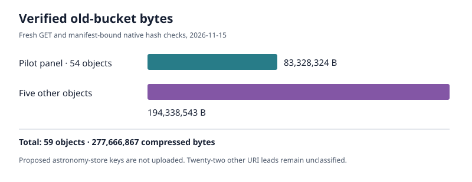

# Five additional N83 factor-base objects: custody audit

**Observed 2026-11-15; local L0.** Five distinct `a=0` objects outside the original 54-object pilot panel were freshly fetched from the original S3 bucket and checked against their frozen source manifests. The [native verifier](../../pilot-01/migration-inventory-native/src/bin/historical.rs) wrote a [five-object inventory](../../pilot-01/migration-inventory-native/INVENTORY_HISTORICAL_20261115.json). It did not upload to the proposed astronomy store, run relations, or select a factor base.

| Source object | Frozen family | Compressed bytes | Compressed BLAKE3 prefix | Source status |
|:--|:--|--:|:--|:--|
| K1182 | size frontier v2 | 5,956,114 | `76e1cbe4` | completed factor-base object |
| K2048 | size frontier v2 | 10,313,647 | `82990cda` | completed factor-base object |
| structured D12 | structured orbit v3 | 10,058,074 | `aea278af` | completed factor-base object |
| standard D18 | standard subspace | 7,263,179 | `ad977df3` | manifest records curve identity |
| full D18 | direct subgroup orbit | 160,747,529 | `c295da88` | exported, unreplayed in source manifest |
| **Five-object total** | | **194,338,543** | | |

The original [pilot audit](REPORT.md) covers 54 objects and 83,328,324 compressed bytes. These two audits therefore verify **59 distinct old-bucket objects and 277,666,867 compressed bytes**. This counts stored bytes, not distinct mathematical factor bases or a complete sweep. The full D18 source status remains `EXPORTED_UNREPLAYED`; its separate [custody receipt](../../pilot-01/migration-inventory-native/source-manifests/full_d18_custody.json) says `PASS_EXACT_FETCH`, which establishes byte custody only.

## Provenance and controls

The six [source snapshots](../../pilot-01/migration-inventory-native/source-manifests/) were copied byte-for-byte from the PR branch's committed historical manifests and D18 custody receipt. Each snapshot was independently compared with `git show HEAD:<original path>`. The verifier requires the expected schema, source status where present, `a=0` or primary curve identity where recorded, canonical old-bucket key, expected compressed byte count and BLAKE3, and decompressed BLAKE3. It additionally checks both SHA-256 values and the exact custody receipt for full D18. Each proposed `s3://setec-astronomy-artifacts/store/sha256/...` URI is a content-addressed **destination proposal**, not evidence of an upload.

Read-only `HeadObject` checks returned the five manifest byte counts. Fresh `GetObject` downloads used the local `default` AWS profile. Native release verification returned five successes and 194,338,543 bytes. Five compressed SHA-256 values matched the independent `sha256sum` command. A second native run produced byte-identical JSON. A changed byte in K1182 returned `compressed object differs from frozen manifest`, exit 1, without creating an output file. Exact commands and validation are in [HISTORICAL_VALIDATION.md](HISTORICAL_VALIDATION.md). The inventory SHA-256 is `45ab7cf1e282991014c4620858c23e4a9bfeb5862192fb8a695428bf7714e05c`.

## Coverage limit and next action

A read-only literal URI scan of the study at this PR head found **81 unique old-bucket `.jsonl.gz` URI strings**. The 59 checked URIs leave [22 other URI leads](OTHER_URI_LEADS.txt): one earlier direct-subgroup D18, 16 other standard-subspace URIs, three projection-map URIs, and two other size-frontier URIs. URI strings alone do not establish that each is a retained, distinct factor base or even an existing S3 object. Classify their source receipts and semantic role, then verify applicable objects with a source-bound native reader before claiming complete historical custody. The proposed writer identity and exact astronomy destination remain pending, so no new-bucket write was attempted. This custody audit does not change the IC leaderboard or any performance graph.
