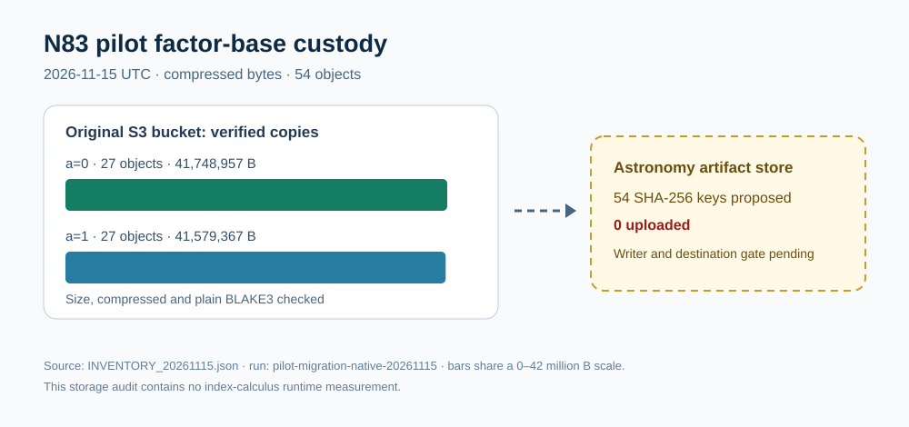

# N83 pilot factor-base custody inventory, 2026-11-15

**Status:** 54 historical objects freshly downloaded and hash-checked; astronomy-bucket paths are proposals only. This is a custody audit, not a factor-base selection or an index-calculus timing run.

## Scope and inputs

The frozen [pilot manifest](../../pilot-01/manifest.json) names 54 compressed factor bases, 27 each for `icv1-f2m83-tm6151469093347-debefd74` (`a=0`) and `icv1-f2m83-t6151469093347-cdcc5432` (`a=1`). The [old upload receipt](../../pilot-01/upload-receipt.json) binds those 54 old-bucket URIs and their compressed BLAKE3 hashes to the manifest. The existing [storage transition](../../STORAGE_TRANSITION_20261027.md) proposes the native write-once store at `s3://setec-astronomy-artifacts/store` for new objects while preserving frozen old-bucket identities. This audit neither changes the original manifest nor mirrors the historical D18 input or source package.

The audit used the `default` AWS profile for read-only `HeadObject` and exact `GetObject` calls to `s3://crypto-autoresearcher/factor-bases/icv1/etc/koblitz_n83_factor_base_sweep_20261008/`. It ran on macOS, local isolation tier L0. Source base commit: `f8c5a80e310b`; verifier source: [main.rs](../../pilot-01/migration-inventory-native/src/main.rs), pinned Rust dependencies: [Cargo.lock](../../pilot-01/migration-inventory-native/Cargo.lock). The downloaded copies were scratch inputs, not committed factor-base files.

## Observations

| Check | Result | Evidence |
|:--|--:|:--|
| Manifest/receipt rows and URI/hash bijection | 54 / 54 | Frozen manifest and upload receipt; native verifier |
| Exact old-bucket HEAD size checks | 54 / 54 | `aws s3api head-object` loop over manifest URIs, 2026-11-15 UTC |
| Fresh old-bucket downloads | 54 / 54 | `aws s3 cp --profile default` for each manifest URI |
| Compressed byte count, BLAKE3, decompressed BLAKE3 | 54 / 54 | [Inventory](../../pilot-01/migration-inventory-native/INVENTORY_20261115.json) and native verifier |
| SHA-256 cross-check with system `sha256sum` | 54 / 54 | `sha256sum` of each fresh download versus inventory |
| Compressed bytes, `a=0` | 41,748,957 B across 27 objects | Inventory |
| Compressed bytes, `a=1` | 41,579,367 B across 27 objects | Inventory |
| Total compressed bytes | 83,328,324 B | Inventory |
| One-byte corruption control | rejected before output | Native verifier: `compressed BLAKE3 mismatch` |
| Astronomy-bucket uploads in this audit | 0 | Inventory `publication_status=not_uploaded` |

The [inventory](../../pilot-01/migration-inventory-native/INVENTORY_20261115.json) records each old URI, compressed and plain BLAKE3, newly calculated compressed SHA-256, byte count, curve identity, and a proposed native store name and content-addressed key. All 54 SHA-256 values are distinct. Proposed keys follow `store/sha256/<first-two>/<full-sha256>`; they are not evidence of an object at that destination. The diagram uses compressed bytes from the inventory and labels the unexecuted destination.

## Reproduction and controls

1. Fetch exactly the 54 URIs in `../../pilot-01/manifest.json` with `aws s3 cp --profile default`, preserving each path under `a0/objects/` or `a1/objects/`. Do not sync the whole prefix: it contains other studies.
2. From the repository root run `RUSTC=<pinned-rustc> CARGO_TARGET_DIR=<scratch-target> <pinned-cargo> run --release --offline --manifest-path research/koblitz_n83_factor_base_sweep_20261008/pilot-01/migration-inventory-native/Cargo.toml -- research/koblitz_n83_factor_base_sweep_20261008/pilot-01 <download-root> <new-output.json>`. This run used Rust `1.99.1-aarch64-apple-darwin`; the output path must not exist.
3. The verifier demands the exact study, panel status and count, receipt-to-manifest BLAKE3 binding, canonical old URI, unique receipt match, compressed byte count and BLAKE3, and decompressed BLAKE3. It calculates SHA-256 only after those checks and writes the output with `create_new`.
4. The corruption control copied the first `a=0` object, changed its first byte, and left the other 53 as symlinks to clean downloads. The process exited nonzero with `compressed BLAKE3 mismatch` and wrote no inventory.

The [validation record](VALIDATION.md) retains the native checks and the nonpassing macOS library gate. The release build's `rust-objcopy` warning was nonfatal; the verifier ran and generated the inventory. This audit does not rerun the curve/point semantic replay; the preexisting [pilot replay](../../pilot-01/replay.json) is separate evidence.

<!-- Render: pandoc REPORT.md --pdf-engine=typst -V fontsize=10pt -V margin.top=0.5in -V margin.bottom=0.5in -V margin.left=0.5in -V margin.right=0.5in -o REPORT.pdf. Inspect both pages. -->

## Decision and open gates

**No new-bucket write was attempted.** Publication requires the owner's exact writer identity and destination, a conditional single-object write and fresh GET, then bulk transfer with provider receipts and a dual-reader successor panel. The D18 mirror and private-source choice remains separate. Primary `a=0` total cold one-target runtime and selected best base remain unset; this custody check changes no performance graph or scoreboard.
