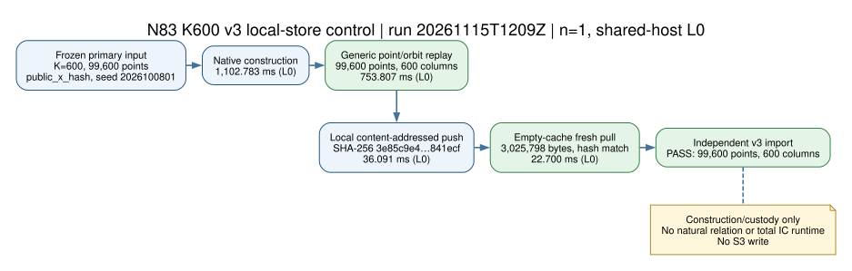

# N83 K600 v3 local-store construction control

**Run:** `20261115T1209Z`, one `a=0` primary K600 base, source
`498efdc53e821edb24fcebf0826ff94549ce266b` on macOS arm64 Darwin 27.2.0.
The [protocol](../../verification/k600-v3-local-custody-20261115/PROTOCOL.md)
was committed before execution. This is a construction and local custody
control, not a relation search or a total-runtime comparison.

| Observed item | Value | Evidence and scope |
|---|---:|---|
| Source and positive control | clean commit; touched release example 26/26 | [raw test log](../../verification/k600-v3-local-custody-20261115/example-test.log) |
| Producer and independent import | exit 0 / exit 0; all v3 receipts `PASS` | [result](../../verification/k600-v3-local-custody-20261115/RESULT.md) and raw exits |
| Complete base | 600 signed-Frobenius columns; 99,600 points | producer generic replay and independent import |
| Point-set BLAKE3 | `ac664f5f0c7122c52a08c0a288b543efb709111a99dc2a5cb2bef025ffffee21` | matches separately frozen historical K600 control |
| Compressed object | 3,025,798 bytes; SHA-256 `3e85c9e419fcddd3c9faed3c84470bf96fcad9178e48e1d73629369335841ecf` | direct file hash, local store index, push/fresh-pull receipts; same hash and size as retained historical K600 object |
| Construction wall | 1,102.783 ms | one shared-host L0 sample, no interval |
| Generic replay wall | 753.807 ms | one shared-host L0 sample, no interval |
| Local publish / fresh pull | 36.091 / 22.700 ms | one shared-host L0 sample each, no interval |
| Total producer process wall | 1,963.477 ms | one shared-host L0 sample, not total IC runtime |

[Diagram source](custody-flow.dot) · [150 dpi PNG](custody-flow.png) ·
[PDF report](REPORT.pdf)

The graph is a **sequence diagram** because this run has one construction
arm and no comparable second run. Its component wall labels are recorded
diagnostics, not a speed comparison or a partition of cold IC cost. The
temporary `file://` remote exercised the store's content-addressed push and
fresh pull. The committed [object and receipts](../../verification/k600-v3-local-custody-20261115/RESULT.md)
are the durable local record; the temporary remote is not S3 custody.

The run host had 9,723,520 KiB free on the study filesystem and one-minute
load 10.54 at admission. The producer's 600-second construction and
900-second outer caps, and the independent importer's 300-second outer cap,
did not fire. Full command, environment overrides, file timestamps, raw
stdout/stderr, source and input identities are in the linked result. The
`rust-objcopy` stripping warning did not change either exit status.

**Limit:** no natural relation, useful rank, column logs, unseen-target
descent, verification, matched rho, or cold end-to-end `S` was measured.
The exact S3 destination and writer remain pending; no new N83 S3 write
occurred. The selected minimum-runtime base remains unset. The canonical
runtime and progress graphs are unchanged because this run supplies only
construction/custody evidence, with no admissible comparative or pipeline
runtime row.
