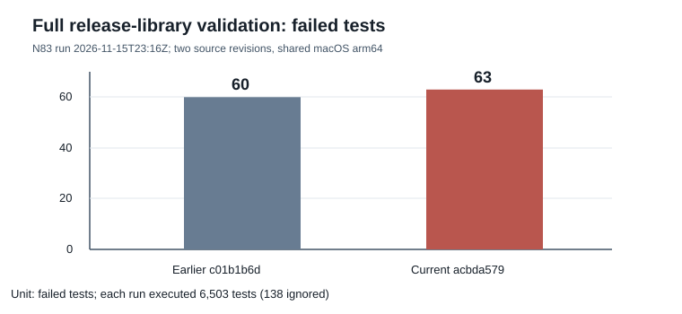

# Current-head root release-library validation — 2026-11-15

**Observed result: required local validation failed.** The frozen [warm full-suite protocol](../../verification/k600-m6-root-library-warm-20261115/PROTOCOL.md) ran at clean source commit `acbda5793b6b19f752bc6ea5e3024565dca72b8b` on shared macOS arm64 with Rust 1.99.1. The terminal [receipt](receipt.txt) records wrapper and child exit **101**, start `23:16:44Z`, end `23:52:00Z`, and no stop signal. The disk guard did not fire. The complete suite reported **6,302 passed, 63 failed, 138 ignored, 0 filtered** in **2,116.12 test seconds**. The exact N83 checkpoint test `cryptanalysis::koblitz_groebner::checkpoint::tests::exact_pivot_state_survives_binary_roundtrip_at_every_column` passed within this suite. This is validation evidence, not a factor-base or relation-search timing.

The command was `RUSTC=/Users/adamburan/.rustup/toolchains/1.99.1-aarch64-apple-darwin/bin/rustc CARGO_TARGET_DIR=/Volumes/SSD990-2/tmp/n83-checkpoint-extended-20261115-target TMPDIR=/Volumes/SSD990-2/tmp/n83-root-lib-warm-20261115-scratch SPOT_NATIVE_TEST_PARENT=/Volumes/SSD990-2/tmp/n83-root-lib-warm-20261115-scratch gtimeout 7200 cargo test --release --lib --locked --offline -j 1 -- --test-threads=2`, invoked by the tracked [launcher](../../verification/k600-m6-root-library-warm-20261115/launch.sh) through the SHA-256-verified `n83.validation-command-receipt/v1` wrapper. This warm Cargo target was reused from the preceding isolated checkpoint test; its setup and the shared host prevent treating the interval as cold IC cost or comparing runtime speed.

The raw log is [compressed here](lib-test.log.gz): 118,230 bytes, SHA-256 `1880c40ad4c23f61e15ad33d88d0dbb53459c58bb4697de466a8edec1f11016f`. Decompression yields 638,332 bytes, SHA-256 `443137637bf74676e09315faf76fd342652150ebb4b2433c59a3b2757b78a638`, matching the receipt. The sorted [63 failing test names](failures.txt) have SHA-256 `945b2a521f04d72b6cdb40df0200b1ab8c71c2351731ca0b67a38ed773e0e604`. The [source commit](source-commit.txt) and [plot data](plot-data.csv) are retained beside the raw records.

The preceding [full-suite attempt](../../verification/k600-m6-native-supervisor-20261115/ROOT_VALIDATION_20261115.md) reported 6,305 passed, 60 failed, 138 ignored at source `c01b1b6d92d5af1b7e5e245c7f890b2a906b7d1a`. Comparing its frozen 60-name list with this run gives **59 shared failures**, four new names in `cryptanalysis::ecbench::record::diagnostic_child_v2_tests`, and one earlier `ml_dataset::solvers::tests::wide_frozen_m13_m15_boundary_retains_terminal_on_both_twists` failure absent here. The four new failures all say `diagnostic root has unprotected shared writable ancestor`. The temporary root for this launch was under `/Volumes/SSD990-2`, whose mode was `drwxrwxr-x` with no sticky bit. `validate_diagnostic_root` rejects writable non-sticky ancestors; the current PR changes no root `src/`, Cargo manifest, or lock file relative to `origin/main`, and `src/cryptanalysis/ecbench/record.rs` has the identical Git blob `9ebb1161d7de50f2aebdb56c72acd964ca53345e` on both. **Inference:** these four are caused by this launch's temporary-root placement, not an N83 source change. The other recurring failures include sparse-checkout missing evidence files and Linux-only fixture paths; this run does not independently prove every base-branch failure.

This gate remains failed. The isolated N83 checkpoint pass and previously passing touched-example tests are distinct validation results. No K600 m6 positive or natural solver arm was launched; matrix rank, target descent, cold total IC runtime, and matched rho remain unmeasured. The canonical IC scoreboard and progress graphs were checked and remain unchanged because this validation produced no IC performance row. The next validation action is to run the release suite on a qualified Linux host with a private temporary root, retaining the exact source, complete receipt, and failures; the distinct K600 Linux build and hard-cgroup preflight still gate any charged relation search.
