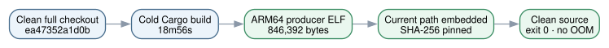

# Current-checkout N83 K600 producer bootstrap

**Measured setup:** full Linux ARM64 bootstrap interval **1,579 seconds** (2026-11-16 04:52:17–05:18:36 UTC), with Cargo's release build **18m56s**. [Frozen protocol](../../verification/k600-colima-bootstrap-current-20261116/PROTOCOL.md) · [launcher](../../verification/k600-colima-bootstrap-current-20261116/launch.sh) · [result](../../verification/k600-colima-bootstrap-current-20261116/RESULT.md).

The source was clean commit `ea47352a1d0bc998642d2412ce9553aa6355f07e`. The pinned image `sha256:2d67b100bee2048d32ea8feb5170be2b13c61d6c70949fbc21c0ffbbff1a4573` provided Linux ARM64, 12 GiB hard memory, zero swap, four CPUs and 512 PIDs. The fresh output-local Cargo target was not copied from a previous run. The native example compiled, installed and hashed [build-producer](build-producer): **846,392 bytes**, SHA-256 `b3dcec9005ce87b26a5a7d5b613781d8dbbc2d5534368d7524c4e36ee3941980`. `file` identified ARM aarch64 ELF, and the in-container byte search plus host `strings` found the current full-checkout path in the binary.

The [raw log](bootstrap.log) is 16,543 bytes, SHA-256 `565d9af84cf3881ac0096110bb54c02cab8a9452896600095048dd441e036ffc`. [Child](bootstrap.child.receipt) and [outer](bootstrap.outer.receipt) receipts record exit 0; [Docker inspection](bootstrap.inspect.json) records `OOMKilled=false`. The final in-container and host worktree checks were clean, and the named container was removed. The [machine summary](checks.json), [diagram source](bootstrap.dot), [SVG](bootstrap.svg), [PNG](bootstrap.png), [PDF](run-report.pdf), [Typst source](run-report.typ) and [source commit](source.commit) are beside this report.

The whole interval is a setup charge. The earlier bootstrap and stopped attempts are retained as separate intervals; no alternative factor-base runtime or speedup is inferred from this compile. The charged binary/solver/image build, K600 worker, natural yield, rank, target descent, matched rho and cold one-target total cost remain open. Canonical IC graphs stay unchanged because this run has no graphable IC result.
