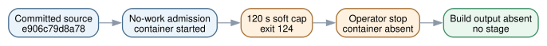

# K600 charged-build retry admission timeout

**Observed:** no-work admission child/wrapper exit 124, 2026-11-16 04:25:15–04:28:04 UTC; no build stage started. [Frozen protocol](../../../verification/k600-colima-charged-retry-20261116/PROTOCOL.md) · [result](../../../verification/k600-colima-charged-retry-20261116/ADMISSION_ATTEMPT_1.md).

The 120-second soft timeout did not end the Docker client/container. The operator stopped the named container and the wrapper then wrote a terminal receipt. The raw [log](admit.log) is zero bytes (SHA-256 `e3b0c44298fc1c149afbf4c8996fb92427ae41e4649b934ca495991b7852b855`); it contains no gate markers, so the expensive check is unknown. The [receipt](admit.receipt) records exit 124 and a 169-second outer interval. The [source commit](source.commit) is `e906c79d8a78e012897ca183cc378ec52ee51270`.

The no-work container was absent after the stop, the new build output directory was absent, and host source remained clean. This is an infrastructure admission limit; no Rust build, solver arm, natural relation, matrix rank, descent, matched rho or total IC cost was measured. The canonical factor-base ranking and graphs remain unchanged for lack of a graphable IC result. The next versioned admission will identify its slow gate, retain hard termination and require every original input/source check to pass.

[Diagram source](admission.dot) · [SVG](admission.svg) · [PNG](admission.png) · [PDF](run-report.pdf) · [Typst source](run-report.typ).
