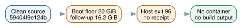

# K600 charged-build retry boot-floor stop

**Observed:** host-side admission exit 96 at clean source `59404f9e124b`; the Docker container and build output were absent. [Prior amendment](../../../verification/k600-colima-charged-retry-20261116/ADMISSION_AMENDMENT.md) · [result](../../../verification/k600-colima-charged-retry-20261116/BOOT_FLOOR_RESULT.md).

The command printed `boot disk below 20 GiB` before its receipt wrapper started. A follow-up 2026-11-16 04:32:36 UTC disk sample gave 17,017,776 KiB available on boot, 56,933,640 KiB on the SSD, and 30,167,616 KiB in the Colima VM root. This sample followed the failure; it is not an exact timestamped sample inside the launcher. There is no raw wrapper log or receipt for this host preflight. The host worktree remained clean.

This is a resource admission stop, with no Rust build or solver arm. It provides no relation, rank, descent, matched rho or total IC measurement, so canonical factor-base graphs remain unchanged. The [versioned next amendment](../../../verification/k600-colima-charged-retry-20261116/BOOT_FLOOR_AMENDMENT.md) sets a 15 GiB boot floor while retaining the SSD/VM floors and all source/input gates.

[Diagram source](boot-floor.dot) · [SVG](boot-floor.svg) · [PNG](boot-floor.png) · [PDF](run-report.pdf) · [Typst source](run-report.typ).
