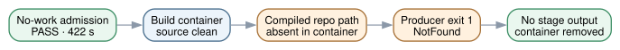

# K600 charged build: compiled source path stop

**Observed:** attempt-4 no-work admission passed at clean source `6716be0e316ccf38375a35b997d1c82745c7ebb3`; the subsequent charged-build child exited 1 before creating an output directory. [Protocol](../../../verification/k600-colima-charged-retry-20261116/PROTOCOL.md) · [amendments](../../../verification/k600-colima-charged-retry-20261116/BOOT_FLOOR_AMENDMENT.md) · [result](../../../verification/k600-colima-charged-retry-20261116/BUILD_ATTEMPT_1.md).

The [admission receipt](admit.receipt) records 2026-11-16 04:34:12–04:41:14 UTC, child/wrapper exit 0, with [raw markers and PASS line](admit.log) confirming the committed plan, input hashes, Linux ARM64 cgroup and producer hash. No admission container or build output remained. The [build child receipt](build.child.receipt) records 04:41:50–04:44:59 UTC, child/wrapper exit 1 and a 76-byte [raw log](build.log), SHA-256 `4a4d3759cbff626df0fa07f9349b9a7de58ccfaa96fbbffbbffc939d55a4d5c8`, containing `Error: Os { code: 2, kind: NotFound, message: "No such file or directory" }`. The [outer receipt](build.outer.receipt) records Docker exit 1, inspect exit 0, image-inspect exit 1, cleanup exit 0 and clean source. [Docker inspect](build.container.inspect.json) reports exit 1 and `OOMKilled=false`. The intended charged output directory and runtime image were absent after cleanup.

The [native producer source](../../../../../examples/n83_k600_m6_linux_build.rs) calls `fs::canonicalize(env!("CARGO_MANIFEST_DIR"))` before it creates the output directory. The retained bootstrap binary's [compiled path excerpt](compiled-source-path.txt) is `/Volumes/SSD990-2/tmp/n83-native-rank-query-wt`, while the attempt-2 build container mounted the full checkout at `/Volumes/SSD990-2/tmp/n83-colima-inputs/n83-full-validation-20261116`. A no-mount check of the pinned image confirmed the compiled path absent. These observations identify a source-path mismatch as the cause of the first `NotFound`, before any Rust-binary stage started. The fix is to rebuild the producer from the current committed checkout and pin its new ELF/hash in a separate bootstrap and build amendment.

This run measured admission and a stopped setup attempt only. No Rust binaries, solver binary, runtime image, K600 worker arm, relation, rank, descent, matched rho or total cold IC comparison resulted. The canonical factor-base graphs remain unchanged. [Diagram source](build-path.dot) · [SVG](build-path.svg) · [PNG](build-path.png) · [PDF](run-report.pdf) · [Typst source](run-report.typ).
