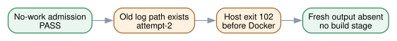

# K600 charged-build log-name preflight rejection

**Observed:** source-correct no-work admission passed at `fd6a7849d77a`, then the build launcher exited **102** before Docker because its log path still named the prior attempt. [Frozen amendment](../../../verification/k600-colima-charged-retry-20261116/CURRENT_PRODUCER_AMENDMENT.md) · [result](../../../verification/k600-colima-charged-retry-20261116/HOST_PREFLIGHT_RESULT.md).

The [admission receipt](admit.receipt) covers 2026-11-16 05:25:51–05:31:14 UTC, exit 0. Its 314-byte [raw log](admit.log), SHA-256 `1710b7c1da942f568413fbaa6638514ea0521607cd0d6f3051d30103139525da`, includes the exact source, plan, input and producer PASS marker. The subsequent build command printed `output exists: /private/tmp/n83-colima-charged-build-20261116-attempt-2.log` and exited 102. It stopped before the wrapper, so no new build receipt/log exists. The intended attempt-3 output and named container were absent.

This records a launcher naming error before setup stages. It supplies no Rust-binary, solver, runtime-image, relation, rank, descent, matched-rho or total IC measurement. Canonical factor-base graphs stay unchanged. The [versioned correction](../../../verification/k600-colima-charged-retry-20261116/LOG_NAME_AMENDMENT.md) uses new names and reruns no-work admission on its new committed source.

[Diagram source](preflight.dot) · [SVG](preflight.svg) · [PNG](preflight.png) · [PDF](run-report.pdf) · [Typst source](run-report.typ).
