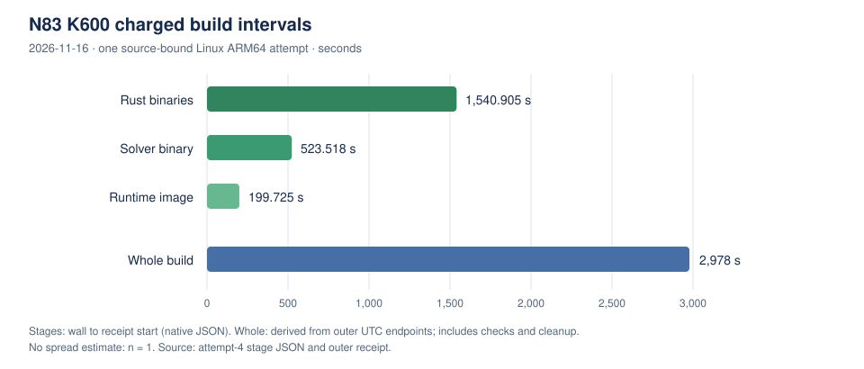

# N83 K600 source-matched charged build passed

**Observed.** The fresh Linux ARM64 charged build at source `ba620214684e41def8bc6caddf2e782f43920218` passed all three stages and produced six executable outputs plus a source-labelled runtime image. The [final native build manifest](build.json) reports `PASS_SOURCE_MATCHED_BUILD`, image `sha256:b84bd73914a2c76a7c8635ee4d40564d974f0fc7188b9e71f315726050bae2b3`, and null `total_index_calculus_runtime_ms`. This is a source-matched *setup component* for the frozen primary N83 `a=0`, K600, m6 candidate; it is not a relation, rank, descent or one-target cost measurement. [Frozen local-solver amendment](../../../verification/k600-colima-charged-retry-20261116/LOCAL_SOLVER_AMENDMENT.md) · [committed plan](../../../verification/k600-colima-charged-retry-20261116/CHARGED_BUILD_PLAN_LOCAL_SOLVER.json).

| Interval | Value | Evidence | Scope |
|:--|--:|:--|:--|
| No-work admission | 184 s, derived from second-resolution UTC endpoints | [admission receipt](admit.receipt) | Separate setup before build |
| Rust binaries | 1,540.905 s, measured | [stage receipt](rust-binaries.json) | Wall to receipt start, PASS, uncapped |
| Solver binary | 523.518 s, measured | [stage receipt](solver-binary.json) | Wall to receipt start, PASS, uncapped |
| Runtime image | 199.725 s, measured | [stage receipt](runtime-image.json) | Wall to receipt start, PASS, uncapped |
| Complete build wrapper | 2,978 s, derived from second-resolution UTC endpoints | [outer receipt](build.outer.receipt) | 06:27:54–07:17:32 UTC; includes launch, checks and cleanup |

One attempt was made; no interval spread was estimated. The stage intervals are sequential and do not include every outer check/write. The [manifest](build.json) records 2,416,378 ms from producer start to receipt start, a distinct internal interval. Do not sum it with the outer interval. The earlier bootstrap, admissions and failed build attempts remain separately charged; this successful build does not erase them. [Graph data](build-cost.csv) contains the values plotted. The whole outer value has up to one-second endpoint rounding per timestamp.

The [admission log](admit.log) and [receipt](admit.receipt) show committed source/plan/script/archive hashes, Linux ARM64, 12 GiB memory, zero swap, four CPUs, 512 PIDs and a Linux-local symlink check. Its child exit was 0. The [build child receipt](build.child.receipt) and [outer receipt](build.outer.receipt) show wrapper/child, Docker inspection, image inspection and cleanup exits all 0, no timeout signal and clean source. [Container inspection](build.container.inspect.json) records `OOMKilled=false`, exit 0, the hard cgroup and pinned toolchain image. [Image inspection](build.image.inspect.json) records `linux/arm64` and the exact source-revision label. The container name was absent after cleanup. The [45-second disk-watch log](disk-watch.log) has 64 samples, minimum boot available 9,718,268 KiB and minimum SSD990-2 available 29,113,728 KiB, both above the 5/20 GiB in-run stop lines; no threshold stop occurred.

The prior bind-mount extraction failure was addressed by extracting and building CryptoMiniSat on Linux-local `/tmp`, verifying both archive symlinks, and copying the finished solver ELF to the shared output. [Solver stdout, losslessly compressed](solver-binary.stdout.gz) records build and version output; [stderr](solver-binary.stderr) and the [stage JSON](solver-binary.json) preserve the exact command and exit. The Rust and runtime-image [stage logs](rust-binaries.stderr) and [runtime-image stderr](runtime-image.stderr) are retained. The six output hashes were independently rechecked against `build.json`; the worker, exporter/replayer and solver SHA-256 values are `d6aad2f3737eff25e2d3759e204b6714e83c58212017b39a650414c7b6ac269b`, `44ab0d6927ee3ab5c79afbaf62b6922cb98591c739e5af87a06a445d367a9852`, and `1aaec2a6ffdfd215075ce8cc7c093e2d884904a161fbf3b77db70c82fc478444`. The other three hashes are in [SHA256SUMS](SHA256SUMS), and all six byte sizes are in [BINARY_SIZES.tsv](BINARY_SIZES.tsv). The six binaries under `binaries/` are committed for the repository's content-addressed artifact migration; any resulting pointer must be independently fetched and checked before a later host uses it. The 1.3 GiB Cargo target is an output-local cache and was not retained as a build product.

**Next gate.** Freeze a source- and image-locked K600 input/staging/preflight packet with the retained K600 object and public fixture hashes; run the native zero-trial preflight under its hard 4 GiB cgroup. A subsequent constructed positive and natural query need a versioned controller allowance that charges every earlier setup attempt as well as this build. No factor-base winner or fully charged one-target `S` follows from this build. The canonical factor-base and rho graphs were checked and left unchanged because this run measures setup only. [Raw build log](build.log) · [source commit](build.source.commit) · [visual source](build-cost.svg) · [inspected PDF](run-report.pdf).
