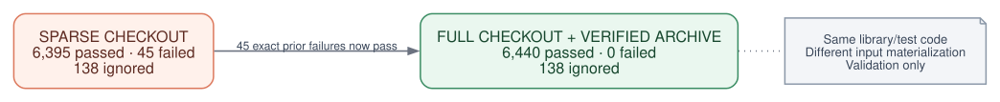

# N83 full-fixture Linux release-library validation

**Status:** local validation passed at source a702129de8e5bd72482d9790f3463028a467926f. This is an input-availability validation, not an IC performance result. [Protocol](../../verification/k600-colima-full-fixture-20261116/PROTOCOL.md) · [mount-path amendment](../../verification/k600-colima-full-fixture-20261116/AMENDMENT-2.md) · [attempt-1 admission failure](../../verification/k600-colima-full-fixture-20261116/attempt-1-admission/ADMISSION.md).

## Source, input and method

The exact command was bash research/koblitz_n83_factor_base_sweep_20261008/verification/k600-colima-full-fixture-20261116/launch-attempt-2.sh. It invoked cargo test --release --lib --locked -j 1, default features, inside the pinned Linux arm64 toolchain image sha256:2d67b100bee2048d32ea8feb5170be2b13c61d6c70949fbc21c0ffbbff1a4573. The full checkout had core.sparseCheckout=false and a clean tracked worktree. The source, Git object and alternate mounts were read-only. The container had 12 GiB hard memory, zero swap, four CPUs, 512 PIDs and a new Cargo target. No AWS credentials or Docker socket were mounted into the test container.

The archived input research/curve25519_f1_targetwalk_20261108/sessions/k20-s0/records.jsonl was restored from s3://setec-astronomy-artifacts/store/sha256/89/8970667e2f18587eeb08d033123dab029b94042ac5c07c870b08988f1ee5b738. The manifest and host/container checks agree on SHA-256 8970667e2f18587eeb08d033123dab029b94042ac5c07c870b08988f1ee5b738 and 2,293,097 bytes. Tracked fixtures including gpu/fes/fes_solve.cpp and the r24 planner records were present. A read-only S3 GET used profile ecc-challenges-new; no factor-base object was uploaded in this validation.

## Measured result

| Run | Main passed | Main failed | Main ignored | Main test time | Whole outer interval |
| --- | ---: | ---: | ---: | ---: | ---: |
| Earlier sparse checkout, source 6a8d673562ae | 6,395 | 45 | 138 | 1,047.78 s | 3,134 s |
| Full checkout plus exact archived input, source a702129de8e5 | **6,440** | **0** | **138** | 1,244.74 s | 3,237 s |

The second run started 2026-11-16T02:49:24Z and ended 03:43:21Z. Its child, Docker and launcher exits were 0; Docker OOMKilled was false, source_clean was true, and container removal succeeded. The main test inventory was 6,578 in both rows. The two one-pass filtered checks in the new log are separate subprocess results and are not added to the main count.

Each of the 45 exact names in [prior-45-failures.txt](prior-45-failures.txt) was found as a passing line in the new raw log; zero were absent. Sort-unique test names extracted from the SHA-verified earlier S3 log readback and new raw log each number 6,578, and comm -3 reports zero names in their symmetric difference. A diff from 6a8d673562ae5f734354bc6b190229862250c3c4 to a702129de8e5bd72482d9790f3463028a467926f changes only reports, artifact pointers and validation protocol files. The command git diff --quiet between those SHAs over src, examples, Cargo.toml, Cargo.lock, crates, gpu and tools exited 0. This is strong evidence that the checkout/input remediation cleared the earlier validation failures. It does not assign a unique missing file to each failed test. The different checkout and fixture state make the time values descriptive, not a benchmark or speedup.

## Raw custody and limits

The byte-preserved raw log is [lib-test.log.gz](lib-test.log.gz), 116,853 compressed bytes, SHA-256 448f858797ba7f9d7351d9b7efd1253aa01990e48452180effba6b5e18ad13dc. It expands to 615,832 bytes, SHA-256 f47c59b201ef0b7ceea55453b8bf78a82cda6045566e171c8b11747d0275344e, matching the [child receipt](child.receipt). The [outer receipt](outer.receipt), [Docker inspect](container.inspect.json), [source commit](source.commit), [machine summary](checks.json) and prior failure list are beside this report. The artifact bot may move the compressed log to S3; its pointer and readback must be verified if that happens.

The [PDF](run-report.pdf), [diagram source](fixture-validation.dot), [SVG](fixture-validation.svg) and [PNG](fixture-validation.png) render this same result. No canonical IC graph changes because this run measures repository validation, not relation yield, rank, descent, answer verification, matched rho or cold one-target IC cost. The charged K600 build still requires a new larger-cap protocol before worker execution. This validation source is a local commit and does not validate a later conflict-resolved PR head.
