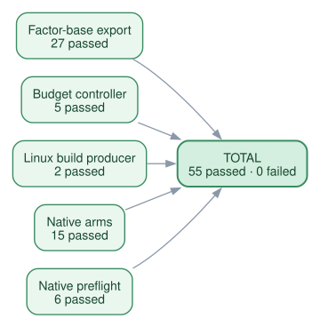

# N83 touched-example release validation

**Status:** five existing touched example targets passed at local source 8e5ffc56747d101c9b655ba7b2c032929a5c048f. [Protocol](../../../verification/k600-colima-full-fixture-20261116/EXAMPLES_PROTOCOL.md) · [launcher](../../../verification/k600-colima-full-fixture-20261116/launch-examples.sh) · [full-fixture library result](../REPORT.md).

The exact command was bash research/koblitz_n83_factor_base_sweep_20261008/verification/k600-colima-full-fixture-20261116/launch-examples.sh. Inside the pinned Linux arm64 image it ran cargo test --release --locked -j 1 with --example flags for koblitz_n83_factor_base_export, n83_k600_m6_budget, n83_k600_m6_linux_build, n83_k600_m6_native_arms and n83_k600_m6_native_preflight. The PR diff also deletes koblitz_halftrace and n83_k600_m6_native_replay, so those have no runnable test target.

| Existing touched example | Passed | Failed |
| --- | ---: | ---: |
| koblitz_n83_factor_base_export | 27 | 0 |
| n83_k600_m6_budget | 5 | 0 |
| n83_k600_m6_linux_build | 2 | 0 |
| n83_k600_m6_native_arms | 15 | 0 |
| n83_k600_m6_native_preflight | 6 | 0 |
| **Total** | **55** | **0** |

The source-path diff gate against library-validation commit a702129de8e5 passed, so the Rust source tested here is unchanged from the 6,440-pass full-library run. The whole example interval was 2026-11-16T03:56:14Z to 04:15:08Z, **1,134 seconds** derived. Cargo's release compilation was 10m55s. It reused the completed library run's Cargo cache and is **not** a cold build or a speedup measurement. The 12 GiB hard memory, zero swap, four CPUs, 512 PIDs, pinned image and read-only source/Git/alternate mounts match the [Docker inspect](container.inspect.json). No AWS credentials or Docker socket were mounted.

The [raw log](examples.log) is 15,020 bytes, SHA-256 709d7915355a68eb357dc841cbd9ea48f2bdd5a2c9b529a665be3c531bac0bd6, matching the [child receipt](child.receipt). The [outer receipt](outer.receipt), Docker inspect, [source commit](source.commit), [machine summary](checks.json), [diagram source](example-tests.dot), [SVG](example-tests.svg), [PNG](example-tests.png), and [PDF](run-report.pdf) are beside this report. Child and Docker exits were 0, OOMKilled=false, source_clean=true and container cleanup passed.

This validates only local source 8e5ffc56747d. A later base merge may change affected code and requires fresh tests. This run does not measure IC relation yield, rank, descent, answer verification, matched rho or cold one-target cost; no factor-base selection or canonical IC graph changes.
