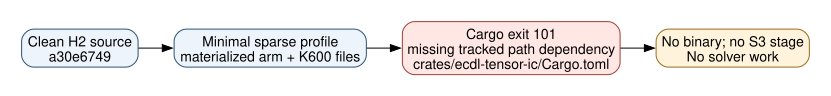

# K600 arm admission attempt 1 stopped on a missing sparse dependency

**Observed:** H2 `a30e67492f821bc6f58ff97c508be9cfe144d7ab` stayed clean. Sparse profile materialization completed, but the first Cargo build stopped at **2026-11-16 08:40:51 UTC** with exit **101** before compilation. Its exact missing tracked file was `crates/ecdl-tensor-ic/Cargo.toml`, a root path dependency absent from the custom-to-minimal sparse transition. [Cargo stderr](build.stderr.log.gz) · [terminal exit](build.exit.txt) · [sparse output](sparse.stdout) · [frozen protocol](../../../verification/k600-arm-admission-20261116/PROTOCOL.md).

The [UTC timestamps](build.start.utc) fall in the same one-second interval. `build.outer-seconds.txt` records zero elapsed whole seconds at second resolution; this does not mean zero resource cost. The [disk sample](build.disk-watch.tsv) remained above the 20 GiB SSD and 5 GiB boot floors. The launcher produced no arm executable or stage receipt and did not run a solver. It left the [first output](RAW_SHA256SUMS) intact. Rust was the pinned 1.99.1 compiler ([version](rustc.version)) and Cargo was 1.93.1 ([version](cargo.version)).

The root Cargo manifest names `ecdl-tensor-ic` as a local path dependency. The [dated amendment](../../../verification/k600-arm-admission-20261116/SPARSE_PATH_AMENDMENT.md) widens the sparse profile with the repository script, checks the other local path dependencies before compilation, and uses new attempt-2 paths. The failure remains a charged setup attempt. It measures no factor-base search or cold one-target IC cost. The canonical IC performance graphs are unchanged because there is no graphable algorithm outcome. [Inspected PDF](run-report.pdf) · [SVG diagram](diagram.svg).
