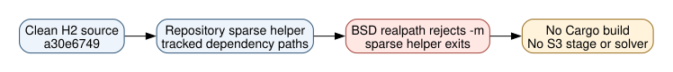

# K600 arm admission attempt 2 stopped on host realpath

**Observed:** the [frozen attempt-2 launcher](frozen-launcher.sh) began at [08:44:03 UTC](start.utc) and exited **1** during sparse materialization. Its [stderr](sparse.stderr) is exactly `realpath: illegal option -- m` followed by BSD usage. The stderr file's [mtime](sparse-stderr-mtime.txt) is 08:46:28 UTC; the script never wrote an end timestamp, so the full outer interval is **unknown**, not the difference between start and mtime. The H2 commit remains `a30e67492f821bc6f58ff97c508be9cfe144d7ab` with direct parent C and a clean tree.

The repository sparse helper uses GNU `realpath -m`, but the ambient host command was BSD `realpath`. Sparse materialization did not complete; Cargo build and read-only K600 stage did not start. No solver or relation work ran. The [frozen sparse-path amendment](../../../verification/k600-arm-admission-20261116/SPARSE_PATH_AMENDMENT.md) remains historically intact. The [dated GNU-tool amendment](../../../verification/k600-arm-admission-20261116/HOST_REALPATH_AMENDMENT.md) defines a third fresh attempt with a 900-second helper cap. [RAW_SHA256SUMS](RAW_SHA256SUMS) covers the copied files; [PDF](run-report.pdf) and [SVG](diagram.svg) are visual copies. The canonical IC graphs remain unchanged because this stopped setup step yielded no algorithm result.
