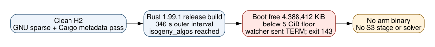

# K600 arm admission attempt 3 stopped at the frozen boot-space floor

**Observed:** the [GNU-tool amendment](../../../verification/k600-arm-admission-20261116/HOST_REALPATH_AMENDMENT.md) passed sparse materialization and offline Cargo metadata. Clean H2 `a30e67492f821bc6f58ff97c508be9cfe144d7ab` began a host-native Rust 1.99.1 release build at [08:54:32 UTC](build.start.utc). The external wrapper ended at [09:00:18 UTC](build.end.utc), **346 seconds** by second-resolution endpoints, with [exit 143](build.exit.txt). The [disk watcher](build.disk-watch.tsv) made 24 samples and recorded a [stop](build.disk-stop.txt) when boot free space reached **4,388,412 KiB**, below the frozen **5 GiB** floor. SSD free space at that sample was **24,294,888 KiB**, above its 20 GiB floor. The 2,700-second process cap did not fire.

The [Cargo stderr](build.stderr.log.gz) shows dependency compilation through `isogeny_algos` and no compiler diagnostic as the terminal cause. The output-local partial target occupied about 491 MiB at inspection and remains outside Git. The current boot-space drop's cause is unestablished; the target directory was on the SSD. There is no complete arm executable or staging receipt. The S3 stage, relation search and solver did not run. H2 remained at C plus its single committed lock and had a clean status after stopping. [Sparse output](sparse.stdout) · [offline metadata](cargo-metadata.json.gz) · [Rust](rustc.version) and [Cargo](cargo.version) versions · [raw checksums](RAW_SHA256SUMS) · [PDF](run-report.pdf).

This is a stopped setup interval, charged along with the earlier sparse-path and host-tool failures. It does not measure relation yield, rank, descent, cold one-target `S` or a best factor base. The canonical IC graphs remain unchanged because there is no algorithm outcome. A later retry requires a new versioned host/resource amendment, a new output path, and a boot-space admission above the same floor; no partial target is treated as a cold completed build.
