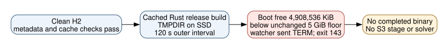

# K600 arm admission attempt 4 stopped again at the boot-space floor

**Observed:** the [boot-floor amendment](../../../verification/k600-arm-admission-20261116/BOOT_FLOOR_AMENDMENT.md) preserved the 5 GiB boot and 20 GiB SSD floors. Clean H2 and offline Cargo metadata checks passed. The cached Rust 1.99.1 build ran [09:09:41–09:11:41 UTC](build.start.utc), **120 seconds** by second-resolution endpoints, then the [watcher](build.disk-stop.txt) sent TERM and the child [exited 143](build.exit.txt). Its last [disk sample](build.disk-watch.tsv) was **4,908,536 KiB boot free**, below 5 GiB; SSD had **21,476,640 KiB free**, above 20 GiB. The 2,700-second process cap did not fire.

`TMPDIR` was output-local on the SSD; the mutable partial target from attempt 3 was reused as a cache, with its [starting size](cache-target-kib-before.txt) recorded. [Cargo stderr](build.stderr.log.gz) shows `isogeny_algos` compilation without a terminal compiler error. The cached target and temporary directory were on the SSD. The boot-space fluctuation's process-level cause is still unverified. The [host cache relocation receipt](../../../verification/k600-arm-admission-20261116/HOST_CACHE_RELOCATION.md) lists the reversible pre-run cleanup. No arm executable or S3 stage receipt was produced. H2 remained a clean one-lock child of C; no solver or relation work ran. [Raw checksums](RAW_SHA256SUMS) · [PDF](run-report.pdf) · [SVG](diagram.svg).

The 120-second failed build interval and all earlier setup attempts remain charged. No factor-base comparison or total cold one-target `S` was measured; canonical IC graphs stay unchanged. The next admission should use verified space on a different local volume or wait for the boot floor to recover, without lowering the frozen thresholds. A fresh output and dated amendment are required before retry.
