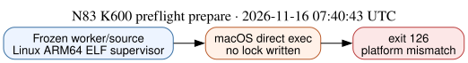

# N83 K600 preflight prepare stopped before lock creation

**Observed:** The first no-work `prepare` invocation at 2026-11-16 07:40:43 UTC exited 126 before creating the source/evidence lock. The Linux ARM64 `preflight-supervisor` executable could not run directly on macOS. The [terminal stderr](stderr.log), [exit code](exit.txt), [UTC endpoints](start.utc), and [command record](command.txt) retain the failure. The endpoint resolution is one second, so no useful elapsed-time estimate follows from equal timestamps. No worker container, circuit or S3 GET was launched.

The retained supervisor digest is `867f36e7e65610260f9d3413ddcccbf19f4b0df984fa655bc45892baa86b901f` from the [source-matched charged build](../../run-20261116-charged-retry/attempt-6-build-success/REPORT.md). This failure is a host execution mismatch. The [committed host amendment](../../../verification/k600-preflight-source-lock-20261116/SUPERVISOR_HOST_AMENDMENT.md) specifies a macOS ARM64 build of the same native supervisor source. The frozen Linux worker and image are retained. No factor-base or relation measurement was made, so canonical IC graphs remain unchanged.
