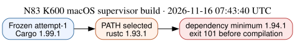

# N83 K600 native macOS supervisor build stopped at compiler selection

**Observed:** The first host-native supervisor build ran from 2026-11-16 07:43:40–07:43:41 UTC and exited 101 before compilation. Cargo was selected with `rustup run 1.99.1`, but its `rustc` lookup found Homebrew Rust 1.93.1; the locked AWS dependencies require at least 1.94.1. The [full stderr](stderr.log), [exit](exit.txt), [UTC endpoints](start.utc), [source commit](source.commit), [toolchain version probe](rustc.version), and [disk sample](disk-watch.tsv) are retained. The one-second endpoint interval is coarse and is not a component timing comparison. No worker, circuit or S3 GET was launched.

The committed [host amendment and attempt-1 launcher](../../../verification/k600-preflight-source-lock-20261116/SUPERVISOR_HOST_AMENDMENT.md) preceded this build. The [attempt-2 amendment](../../../verification/k600-preflight-source-lock-20261116/RUSTC_PATH_AMENDMENT.md) pins the actual 1.99.1 compiler path and a fresh target directory. This failure is a compiler selection issue, not a K600 capacity observation. Canonical IC graphs remain unchanged.
