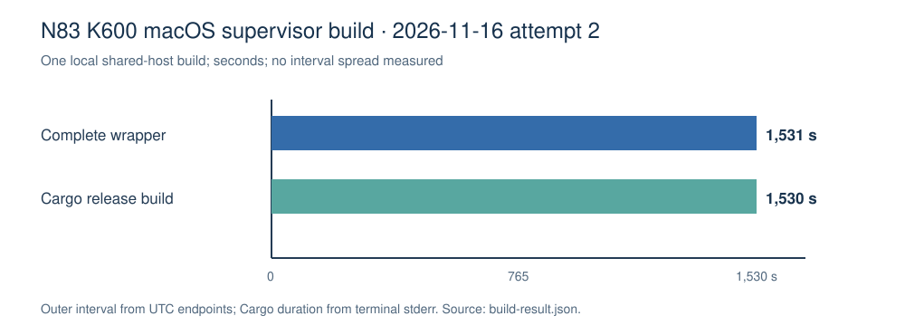

# N83 K600 host-native preflight supervisor built

**Measured setup:** The macOS ARM64 supervisor build passed from 2026-11-16 07:44:48–08:10:19 UTC, **1,531 seconds** by second-resolution outer endpoints. Cargo reported **25m30s (1,530 seconds)** for its release build. Both values describe one shared-host build; neither is a factor-base search timing or an independently isolated comparison. [Frozen retry amendment](../../../verification/k600-preflight-source-lock-20261116/RUSTC_PATH_AMENDMENT.md) · [machine result](build-result.json) · [full stderr](stderr.log) · [terminal exit](exit.txt).

The binary is Mach-O arm64, 1,284,960 bytes, SHA-256 `3ea86decaf897e800aa3f78c5b028c1505b71fe1637cbb858ad717907f0284c0`. [File inspection](binary.file), [digest](SHA256SUMS) and [raw binary](binaries/mac-preflight-supervisor) are retained for artifact-store migration. Rust was explicitly pinned to 1.99.1; Cargo used `--release --locked --offline -j 1` and a fresh external target. The [disk watcher](disk-watch.tsv) sampled 51 times; its minimum was 27,872,968 KiB available, above the 20 GiB stop floor. No disk stop occurred. `stderr.log` includes 57 compiler warnings and Cargo's final success line. The [UTC start](start.utc), [end](end.utc), and [source commit at start](source.commit) are retained; the outer endpoint value has up to one-second rounding at each endpoint.

The PR head advanced from `3777267245e7fe1bac3a95b57826ba87d3dc2269` to `9914f5dbcf88` during the build to commit only the two earlier stopped-attempt reports. `git diff --quiet` confirmed no differences in `src`, `examples`, `Cargo.toml`, `Cargo.lock`, `crates`, `gpu` or `tools` across those revisions or against Linux build source `ba620214684e41def8bc6caddf2e782f43920218`. The generated executable is host-native; the retained Linux worker and source-labelled runtime image remain separate. The [previous two stopped attempts](../attempt-1-host-exec/REPORT.md) and [compiler-selection stop](../attempt-2-mac-build-rustc/REPORT.md) remain charged setup.

**Next gate:** Commit the exact supervisor hash and path before native `prepare`, then create a one-lock evidence commit directly on source `ba620214684e` and run one zero-trial preflight under the frozen 240/300-second worker/outer caps. The full cold one-target ledger must retain this 1,531-second build and all earlier setup. Canonical IC graphs remain unchanged because this is a setup build. [Graph data](build-intervals.csv) · [inspected run PDF](run-report.pdf) · [results PDF](results-report.pdf).
