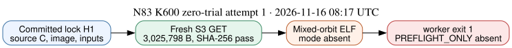

# N83 K600 zero-trial preflight stopped at executable selection

**Observed:** The native supervisor ran from 2026-11-16 08:17:25–08:17:28 UTC. It wrote `PRODUCER_FAILURE_worker_exit`, worker exit 1 and `timed_out=false`; its internal `elapsed_wall_ms` was 2,527.105791. The complete outer interval is 3 seconds by second-resolution endpoints. [Native outer receipt](native-outer.json) · [outer wrapper exit](exit.txt) · [UTC endpoints](start.utc) · [launch arguments](launch.json) · [worker stderr](worker.stderr.log).

The committed failed lock `H1=4905dd76dbf619c6a33ae82c1bdec7713b0a9c29` bound the Linux ARM64 `koblitz_n83_mixed_orbit_worker` ELF, SHA-256 `d6aad2f3737eff25e2d3759e204b6714e83c58212017b39a650414c7b6ac269b`. The supervisor invoked mode `primary-store-v3-orbit-chain-cold`; [the source dispatch](../../../../../examples/koblitz_n83_factor_base_export.rs) implements this mode in `koblitz_n83_factor_base_export`, whose retained ELF SHA-256 is `44ab0d6927ee3ab5c79afbaf62b6922cb98591c739e5af87a06a445d367a9852`. The selected worker printed its usage and exited before creating a K600 circuit or config/summary receipt. The [failed H1 lock](failed-lock-H1.json) and remote `codex/n83-k600-preflight-lock-20261116` branch preserve that source/evidence identity. This is a program selection defect, not a capacity verdict.

The fresh read-only factor-base GET did complete before worker execution. [Launch receipt](launch.json) and [independent local digest/size check](S3_INPUT.json) record 3,025,798 bytes matching SHA-256 `3e85c9e419fcddd3c9faed3c84470bf96fcad9178e48e1d73629369335841ecf`. The original [adoption manifest](../../../verification/k600-v3-s3-adoption-20261115/attempt-1/manifest.json) names the same object. The [disk samples](disk-watch.tsv) recorded no floor stop, and [residual container check](residual-container.txt) was empty. No cgroup peak or solver call was reported because the executable rejected its mode before producing a worker receipt. No relation, rank or target-work measurement followed; canonical IC graphs remain unchanged.

The [frozen executable correction](../../../verification/k600-preflight-source-lock-20261116/WORKER_PROGRAM_CORRECTION.md) creates a new clean `C→H2` lock on the exporter ELF in a separate worktree and reruns one zero-trial preflight with the same limits. Earlier evidence is unchanged. [Diagram source](diagram.dot) · [inspected PDF](run-report.pdf).
