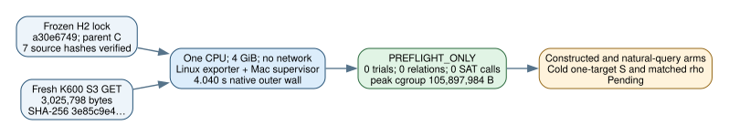

# N83 K600 zero-trial preflight passed on frozen H2

**Observed, one run.** The 2026-11-16 08:23:50–08:23:55 UTC external wrapper exited 0. The native supervisor reported `PREFLIGHT_ONLY`, worker exit 0, no timeout or failure reasons, and **4,040.215208 ms** outer wall. The external second-resolution endpoints span 5 seconds; they are a separate measurement. [Native outer](native-outer.json) · [launch](launch.json) · [worker summary](summary.json) · [config](config.json) · [events](events.jsonl) · [external timestamps and exit](start.utc) · [audit](audit.txt).



The [frozen H2 lock](LOCK-H2.json), SHA-256 `b97fd192c5ab2af87bd368062014b2c4bef643e791cf6a0ab335a1197c986cae`, is commit `a30e67492f821bc6f58ff97c508be9cfe144d7ab` on branch `codex/n83-k600-preflight-lock2-20261116`, directly atop source C `ba620214684e41def8bc6caddf2e782f43920218`. Its only changed file is the lock. [Independent cross-check](audit.sh) verified clean H2, the one-file diff, all seven source hashes from C, Linux exporter SHA-256 `44ab0d6927ee3ab5c79afbaf62b6922cb98591c739e5af87a06a445d367a9852`, and macOS supervisor SHA-256 `3ea86decaf897e800aa3f78c5b028c1505b71fe1637cbb858ad717907f0284c0`. [Source attestation](attestation.json) reports clean C. The Linux exporter and macOS supervisor are retained by content-addressed artifact-store pointers from the earlier [charged build](../../run-20261116-charged-retry/attempt-6-build-success/REPORT.md) and [host build](../attempt-3-mac-supervisor-build/REPORT.md); those prior setup intervals remain separate and charged.

The run used the already-published K600 signed-Frobenius factor base: 600 orbit columns, 99,600 points, (a=0), (m=6), policy `public_x_hash`, seed 2026100801. A fresh GET under `s3://setec-astronomy-artifacts/store` produced 3,025,798 bytes with SHA-256 `3e85c9e419fcddd3c9faed3c84470bf96fcad9178e48e1d73629369335841ecf`. The [store index](store-index.json), [launch receipt](launch.json), [lock](LOCK-H2.json), and independent `shasum` of the fresh cache all agreed. The object is retained at `s3://setec-astronomy-artifacts/store/sha256/3e/3e85c9e419fcddd3c9faed3c84470bf96fcad9178e48e1d73629369335841ecf`; this run performed no new factor-base publication.

The container was limited to one CPU, 4 GiB memory, no swap and no network. The observed memory-cgroup peak was **105,897,984 bytes** (about 101 MiB), from the producer's [summary](summary.json) and [stdout](worker.stdout.log.gz). The external [disk sample](disk-watch.tsv) recorded SSD 27,632,368 KiB and boot 8,613,444 KiB free, above the 20 GiB and 6 GiB stop floors. The [residual container record](residual-container.txt) is empty. The wrapper produced no stderr. The frozen worker cap was 240 seconds and outer cap 300 seconds; neither fired.

The producer had **zero trials, zero relations, zero SAT calls, zero matrix rows, rank zero, and no solver stage**. `linear_solve_attempts=1` and `rank_checks=1` refer to its zero-row check. No scalar answer or cold end-to-end `S` was produced or measured. This is a passed source/input/resource preflight only. It has one sample and no paired comparator, variance estimate, best-base selection or rho ratio. The [frozen protocol](../../../verification/k600-preflight-source-lock-20261116/PROTOCOL.md) and [executable-selection amendment](../../../verification/k600-preflight-source-lock-20261116/WORKER_PROGRAM_CORRECTION.md) govern this attempt; [attempt 4](../attempt-4-wrong-executable/REPORT.md) remains a failed charged attempt.

**Reproduce the receipt cross-check** (requires H2, the retained output directory and binaries):

```sh
bash audit.sh /Volumes/SSD990-2/tmp/n83-colima-inputs/n83-k600-preflight-c-20261116-attempt-2 /Volumes/SSD990-2/tmp/n83-colima-output/k600-preflight-20261116-run-attempt-2 /Volumes/SSD990-2/tmp/n83-colima-output/charged-20261116-attempt-4/exporter /Volumes/SSD990-2/tmp/n83-colima-output/k600-preflight-mac-supervisor-build-20261116-attempt-2/target/release/examples/n83_k600_m6_native_preflight
```

Raw wrapper stdout/stderr and worker stdout/stderr are retained as `.gz`; [SHA256SUMS](SHA256SUMS) lists the copied machine receipts. The audit is a receipt cross-check, not an independent cryptographic replay. [Run PDF](run-report.pdf) · [results PDF](results-report.pdf) · [SVG diagram](diagram.svg) · [150 dpi PNG](diagram.png).

**Next gate.** Freeze a versioned controller allowance and exact source/host/input identity for the constructed and natural-query arms. Run their bounded controls and account for construction, publication, all stopped attempts/builds, this preflight, relation search, rank/linear algebra, descent and verification in the eventual cold one-target total. The canonical IC performance graphs remain unchanged because this attempt measured no search or end-to-end outcome.
