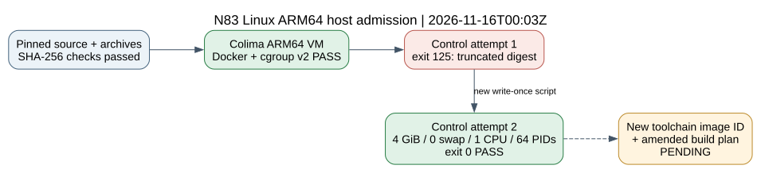

# N83 Linux ARM64 host admission — visual run report

The [frozen host protocol](../../verification/k600-colima-host-20261115/PROTOCOL.md) started one local Colima `aarch64` VM at 2026-11-16 00:03 UTC. Its [terminal host receipt](../../verification/k600-colima-host-20261115/host-start.receipt) records exit 0 after 29 seconds. The first bounded no-work container control failed before container start because its script truncated the pinned image digest; the [first failure](../../verification/k600-colima-host-20261115/ATTEMPT_1.md) and raw receipt are retained. The separately committed corrected [attempt 2](../../verification/k600-colima-host-20261115/control-attempt-2.sh) exited 0 after 18 seconds and observed hard cgroup limits of 4 GiB memory, zero swap, one CPU and 64 PIDs. Both intervals are infrastructure/validation observations, outside any IC cost row.

The [full result](../../verification/k600-colima-host-20261115/RESULT.md) links the raw logs, receipts, host-state record, source revisions and image digest. The VM reports Linux ARM64, Docker 29.5.2 and cgroup v2; the no-work control used the pinned Rust image `sha256:e6f2cff35d0f309acf8433b4f05878ed77092602c5065cc81801177da0bb3a9c`. A later source-locked K600 toolchain image needs a new exact image ID and versioned build-plan amendment. The Linux root library suite, K600 positive/natural arms, matrix rank, descent, matched rho and cold total IC runtime remain pending. No canonical IC graph changes because this host admission produced no relation or runtime comparison.

The diagram is explanatory: it shows the observed pass/failure sequence and the next gate. It is not a performance plot because this run has no comparable algorithm measurements. Its editable source is [host-flow.dot](host-flow.dot); the inspected [PDF](run-report.pdf) embeds the same SVG.
