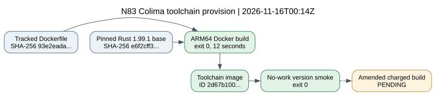

# N83 Colima toolchain image provision — visual run report

The [frozen protocol](../../verification/k600-colima-toolchain-20261116/PROTOCOL.md) used the qualified local Colima ARM64 Docker daemon and the tracked Dockerfile at clean source `317f53dad49872ba9c9ef1aaa647a78bc89fad0b`. The [terminal build receipt](../../verification/k600-colima-toolchain-20261116/build.receipt) records exit 0 from 2026-11-16 00:14:35–00:14:47 UTC. The resulting local image ID is `sha256:2d67b100bee2048d32ea8feb5170be2b13c61d6c70949fbc21c0ffbbff1a4573`, Linux ARM64. A separate [no-work smoke](../../verification/k600-colima-toolchain-20261116/smoke.receipt) exited 0 and checked Rust 1.99.1, CMake 3.25.1, Git, Docker CLI and GMP versions. These intervals are infrastructure observations, not IC algorithm timings.

The [result record](../../verification/k600-colima-toolchain-20261116/RESULT.md) links the exact Dockerfile blob/content hashes, pinned Rust base digest, complete build/smoke logs, image inspection/history and terminal receipts. The old charged-build plan pins an image ID absent on this daemon; a versioned Colima plan amendment is next. No five-binary K600 build, solver, zero-trial worker preflight, relation search, rank, descent, matched rho or total cold one-target IC runtime was measured. The diagram distinguishes observed stages from the dashed pending stage. No canonical IC graph changes because this run supplies no IC cost comparison. The editable diagram source is [image-flow.dot](image-flow.dot), and the [inspected PDF](run-report.pdf) embeds the rendered SVG.
