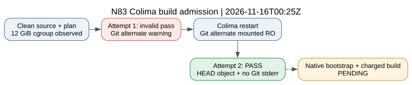

# N83 Colima build admission — visual run report

The [versioned Colima plan](../../verification/k600-colima-charged-build-20261116/AMENDMENT.md) pinned a new ARM64 toolchain image while retaining the original three build-stage limits and hashes. The first [no-work admission attempt](../../verification/k600-colima-charged-build-20261116/ADMISSION_ATTEMPT_1.md), started at 2026-11-16 00:25 UTC, recorded 12 GiB memory, zero swap, four CPUs and 512 PIDs, but printed a Git alternate-object warning. Its exit 0 is an **invalid pass** because the source gate omitted that warning. The [frozen mount correction](../../verification/k600-colima-charged-build-20261116/ALTERNATE_MOUNT_AMENDMENT.md) restarted the same Colima profile with the exact alternate store read-only. The stricter [second admission](../../verification/k600-colima-charged-build-20261116/ADMISSION_RESULT.md) exited 0, verified the `HEAD` commit and plan blob from Git, and required empty Git stderr.

The result record links both raw logs/receipts, the stop/start receipts, exact source revisions, image ID and hashes. The diagram's dashed edge is a pending native bootstrap and charged build, not executed work. The no-work validation produced no factor-base yield, solver, rank, target descent, matched rho or complete cold IC runtime. No canonical IC graph changes. The editable [DOT source](admission-flow.dot) and [inspected PDF](run-report.pdf) are beside this report.
