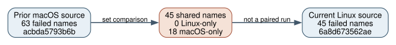

# N83 current-head Colima release-library validation — run report

**Run ID:** `run-20261116T0137Z`. **Status:** full suite completed with a failed validation gate. The [protocol and launcher](../../verification/k600-colima-linux-lib-20261116/PROTOCOL.md) were committed at `6a8d673562ae5f734354bc6b190229862250c3c4` before execution. The source commit in the [outer receipt](outer.receipt) is the same, and the checkout was clean after the run.

| Quantity | Observed value | Evidence |
| --- | ---: | --- |
| Whole interval | 2026-11-16 01:37:37–02:29:51 UTC; derived 3,134 s | [outer receipt](outer.receipt) |
| Main library suite | 6,395 passed; 45 failed; 138 ignored; 0 filtered | compressed raw log, SHA-256 below |
| Main suite test time | 1,047.78 s | Cargo terminal summary in raw log |
| Child / Docker exit | 101 / 101 | [child receipt](child.receipt), [Docker inspect](container.inspect.json) |
| Docker `OOMKilled` | `false` | [Docker inspect](container.inspect.json) |
| Hard cgroup | 12 GiB memory, zero swap, four CPUs, 512 PIDs | committed launcher checks; Docker inspect confirms limits |
| Command | `cargo test --release --lib --locked -j 1` | [launcher](../../verification/k600-colima-linux-lib-20261116/launch.sh) |
| Linux failed-name set | 45; [sorted list](linux-failures.txt) | main suite log |
| Prior macOS failed-name set | 63; [prior list](../run-20261115T2316Z/failures.txt) | prior source `acbda5793b6b` |
| Set intersection and differences | 45 shared; 0 Linux-only; 18 macOS-only | [shared](shared-failures.txt), [Linux-only](linux-only-failures.txt), [macOS-only](macos-only-failures.txt) |

Two filtered child summaries in the log each reported one pass; they are not added to the main suite's 6,395 passes. The wrapper and child exits were 101, with no wrapper stop signal. Docker reported exit 101 and `OOMKilled=false`; outer cleanup succeeded and no named container remains. The source was mounted read-only at its actual path with the Git common and alternate object stores, and compilation used a new output-local target. The test runner used the hard Linux ARM64 cgroup and ran to its own terminal summary within the 7,200-second outer cap.

The Linux [45-name set](linux-failures.txt) is wholly contained in the earlier macOS [63-name set](../run-20261115T2316Z/failures.txt). This is a descriptive set comparison across different source revisions and hosts, **not** an A/B test or evidence that a source change fixed 18 failures. The failure text shows missing fixtures in this sparse checkout. `gpu/certicom` and `gpu/fes/fes_solve.cpp` are tracked paths; `research/ic_planner_validation_20261020/sessions/r24/records.jsonl` and `research/ecbench_rootfinding_batchtable_20261013/followup/reports/holdout/REPORT.md` are tracked; `research/curve25519_f1_targetwalk_20261108/sessions/k20-s0/records.jsonl` is absent from Git while `.artifacts.json` exists for that session. This last object needs an exact artifact restore, not merely a wider sparse checkout. The failure list may contain additional causes, which have not been independently isolated one by one.

The byte-preserved raw log is compressed as `lib-test.log.gz` in this result commit. Its compressed size is **119,992 bytes**, SHA-256 `3d9f11ba463f7c32732ae484dea2980e78b264a50d1776a7d3f53c7f4d98f850`; `gzip -dc` yields **640,511 bytes**, SHA-256 `9879654194ce14336a9979e9b5414ee1a0a45aff6a05a8cb70b554eba39b2f51`, matching the [child receipt](child.receipt). GitHub artifact-autofix may migrate the compressed blob to S3 and add `.artifacts.json`; verify that pointer and update this custody note if it does. The [source commit](source.commit), [Docker inspect](container.inspect.json), failure lists, and receipts stay beside this report. The local Cargo target is a disposable validation cache.

The [editable DOT](failure-sets.dot) and [inspected PDF](run-report.pdf) accompany this report. This test run contains no relation yield, rank, descent, matched rho, or cold one-target IC runtime. No canonical IC graph changes. The release-library gate remains red; the stopped charged build is a separate gate. The next validation action is a full materialized checkout and hash-verified restoration of archived fixtures at the final PR head, followed by the same full suite. The [verification result](../../verification/k600-colima-linux-lib-20261116/RESULT.md) preserves that open obligation.
