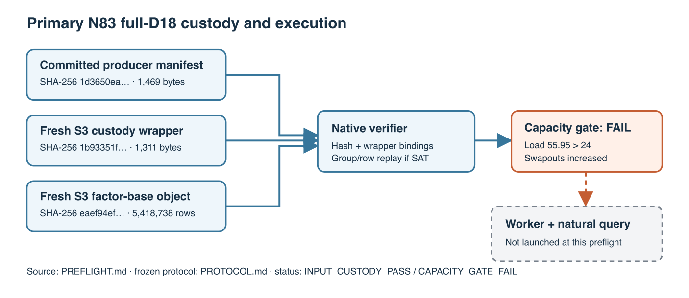

# Native D18 cadence-32 input and capacity preflight

**Status, 2026-10-26:**

- `INPUT_CUSTODY_PASS`
- `CAPACITY_GATE_FAIL`
- `WORKER_NOT_LAUNCHED`

This is a preflight record for the [frozen
protocol](PROTOCOL.md), not a relation search or a factor-base ranking.
`selected_best_total_runtime` remains `null`.



## Exact input and source

The primary curve is Koblitz `a=0` over GF(2^83). Its subgroup order is:

```
2417851639230796216685689
```

Its exact curve ID is:

```
icv1-f2m83-tm6151469093347-debefd74
```

This preflight used the clean source commit on [PR #2649](https://github.com/isogeny-labs/crypto/pull/2649):

```
1fde65e5e5165dc23de03b555913d8d15f957cce
```

| Artifact | Bytes | Local SHA-256 prefix |
|:--|--:|:--|
| [Committed producer manifest](../manifest.json) | 1,469 | `1d3650ea…` |
| [S3 custody wrapper](evidence/s3-manifest.json) | 1,311 | `1b93351f…` |
| S3 compressed full-D18 object | 160,747,529 | `eaef94ef…` |

Full local SHA-256 values, in table order:

```
1d3650eabc4662d8f2597498d7ac92b7cd0a4134ac5f8155aaa49c7af3407dce
1b93351febd47dac4de8c5dd39dbf58564d0057a044054baf448d978f6c0d616
eaef94ef45b3d2d4cd2ec2f40c1173b4cdb2a437b7e618a858c73fb1caf3902b
```

Both S3 objects were freshly fetched into scratch from this bucket:

```
crypto-autoresearcher
```

The [AWS handoff](../AWS_RESUME.md) gives their complete keys. The retained
provider GET receipts are [wrapper](evidence/manifest-get-metadata.json) and
[object](evidence/object-get-metadata.json). Their SHA-256 values follow:

```
3cc440bf5e5eb6a943dd534f6af5cb48f49b4b3d3ebf87eed62a701f96a49172
1578b28a45f0a4f892bbb013ea10fcdd126fd543105d7b2084bac6e74610835a
```

Their base64 `ChecksumSHA256` fields decode to the local hashes above; both
report `ChecksumType=FULL_OBJECT` and AES256 at rest. The wrapper binds the producer
manifest, curve, policy, object key, 32,643 columns and 5,418,738 point rows.
The [native verifier](../../../../../examples/n83_d18_native_relation_replay.rs)
now checks these distinct manifests and bindings before replay.

The release worker and verifier SHA-256 values are, respectively:

```
afd2fe3870f758d96dd97f1982c85d65d6ebb210659133dc93b1d3f5fda1146b
5f7679ee4b001438bdd27de49f8a4935f9e9803bf00a56e0045f502d1a7e1ab9
```

Both were built from the clean commit above:

```sh
cargo build --release \
  --example koblitz_n83_factor_base_export \
  --example n83_d18_native_relation_replay \
  --target-dir /private/tmp/n83-evidence-cargo-target
```

## Validation and capacity

The committed patch passed the focused verifier tests (3), historical N83
suite (63, plus 70 subtests), and boundary suite (52, plus 9 subtests).
The full release library rerun with loopback access and four test threads
passed 4,168 tests, with 117 ignored and zero failed. The [retained compressed
log](evidence/full-release-lib-4threads.log.gz) is 67,218 bytes. Its
compressed and uncompressed SHA-256 values are, respectively:

```
c87c54d070460b5c56d77d027240ae0f4d9ae610889fa0be18c5ebb541860cb3
b129cdeb7e2b88cecd80357b02b6f17381a0d308532869d9dae59c5c68328d8a
```
An earlier default-sandbox full-suite attempt failed 14 existing tests under
restricted loopback and host contention; it is not a passing gate. Focused
Clippy, targeted rustfmt and diff checks passed; Clippy emitted the existing
unknown-lint warning from the repository configuration.

The [protocol](PROTOCOL.md) requires one-minute host load at most 24, no
swapouts during the run, and at least 2 GiB scratch free. The shared Mac had
86 GiB scratch free at 12:52 PDT, but sampled one-minute load was **74.19** at
12:51, **63.05** at 12:52, **66.80** at 12:55 and **55.95** at 12:56. The
`vm_stat` cumulative swapout count rose from 299,564 at 12:51 to 353,036 at
12:56. These are sparse host observations, not a continuous utilization
trace. This capacity state fails the frozen launch gate. The worker was not
started, and neither a positive nor a natural outcome exists for this
checkpoint.

One connection attempt to `awsspot` timed out during SSH banner exchange;
the configured `runpod` and `runpod-isolated-blush-stork` endpoints each
refused the connection. The AWS spot lifecycle controller reported a ready
compute instance but `ssh_endpoint_ready=false`; its bounded wake request
did not make the endpoint ready within 30 seconds. The hosted AWS principal's
exact-object read grant remains unapplied. GitHub Actions for PR #2649 failed
before runner assignment with the account billing/spending-limit annotation
recorded in the PR comment. None of these are solver observations.

## Next gate

On a reachable authorized host, check the source and fresh full-object S3
GETs, rebuild and hash both release binaries, and record a host preflight.
Only then launch one 300-second internal-cap constructed control. A passing
native group/row replay is required before one 2,400-second natural query.
Independent assignment replay, useful-rank closure, full-width logs,
unseen-target descent, fully charged cold one-target cost and matched rho
remain necessary before selecting a factor base by total runtime. The
[existing problem record](../../../../../problems/n83-mixed-orbit-factor-base-selection.md)
tracks those unresolved gates.

The visual source is [CUSTODY.svg](CUSTODY.svg). Its PNG was rendered from
that SVG at 1,406 × 609 pixels with `rsvg-convert` and tagged 150 dpi with
`sips`. The report PDF was built from this Markdown and PNG with Pandoc and
Tectonic.
