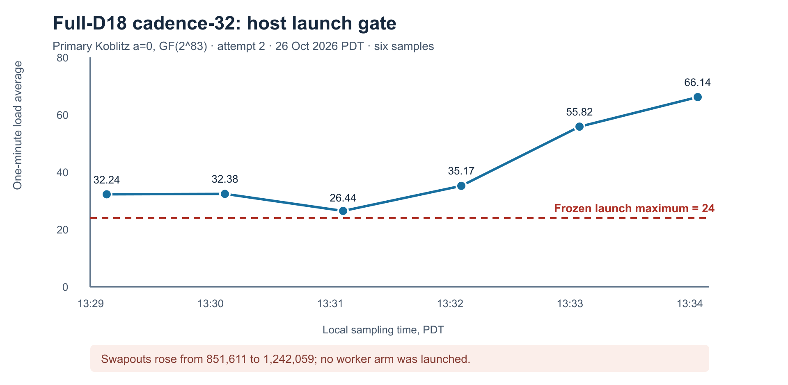

# Full-D18 native cadence-32: second input and host preflight

**2026-10-26, primary curve:** `icv1-f2m83-tm6151469093347-debefd74`, Koblitz `a=0` over GF(2^83), subgroup order `2417851639230796216685689`.

**Observed state:** `INPUT_CUSTODY_PASS`; `CAPACITY_GATE_FAIL`; `WORKER_NOT_LAUNCHED`. This is a fresh source-bound preflight for the [frozen positive-then-natural protocol](../PROTOCOL.md) and its [retained-assignment amendment](../ASSIGNMENT_CERTIFICATE_AMENDMENT.md). It is neither a relation-search result nor an index-calculus total-runtime measurement. `selected_best_total_runtime` remains `null`.



## Inputs and implementation identity

The clean source was commit `45ce91d503ee0d0acc57e3d8d5cb49108c90ded6` on [PR #2649](https://github.com/isogeny-labs/crypto/pull/2649). Both release examples were built with:

```sh
cargo build --release --example koblitz_n83_factor_base_export \
  --example n83_d18_native_relation_replay \
  --target-dir /private/tmp/n83-evidence-cargo-target
```

| Artifact | SHA-256 prefix | Bytes or role |
|:--|:--|:--|
| [Committed producer manifest](../../manifest.json) | `1d3650ea…` | Producer identity |
| [Fresh S3 wrapper](evidence/s3-manifest.json) | `1b93351f…` | 1,311 bytes |
| Full-D18 compressed S3 object | `eaef94ef…` | 160,747,529 bytes |
| Release worker | `11220d8b…` | Frozen worker binary |
| Release verifier | `e8957870…` | Separate replay binary |

Full SHA-256 values in table order:

```text
1d3650eabc4662d8f2597498d7ac92b7cd0a4134ac5f8155aaa49c7af3407dce
1b93351febd47dac4de8c5dd39dbf58564d0057a044054baf448d978f6c0d616
eaef94ef45b3d2d4cd2ec2f40c1173b4cdb2a437b7e618a858c73fb1caf3902b
11220d8b838bf5cac2985dbcba4ea96e69a64b70dc54044d180cf6a3e8970e49
e89578703888568d67f79e5b2645e47b911a30a9d7a8a3d57e795be997296b71
```

The full object and wrapper were freshly fetched with `aws s3api get-object --checksum-mode ENABLED` into `/private/tmp/n83-native-cadence-20261026.6bLNUn/base2`. The local SHA-256 values above matched their provider `ChecksumSHA256` fields; both [object](evidence/object-get-metadata.json) and [wrapper](evidence/manifest-get-metadata.json) GET receipts specify `ChecksumType=FULL_OBJECT`. The object stays at the immutable S3 key given in [AWS_RESUME.md](../../AWS_RESUME.md), rather than in Git. SHA-256 of the two provider metadata JSON files, object first and wrapper second:

```text
1578b28a45f0a4f892bbb013ea10fcdd126fd543105d7b2084bac6e74610835a
3cc440bf5e5eb6a943dd534f6af5cb48f49b4b3d3ebf87eed62a701f96a49172
```

## Host launch gate

The protocol requires one-minute load at most 24, no *new* swapouts during launch/run, and at least 2 GiB scratch free. The cumulative swapout counter was already nonzero at inspection; its **delta** is the relevant check. The observed samples are retained in [host-samples.tsv](host-samples.tsv) and plotted in [HOST_GATE.svg](HOST_GATE.svg). Six selected observations were:

| Local time PDT | One-minute load | Cumulative swapouts |
|:--|--:|--:|
| 13:29:49 | 32.24 | 851,611 |
| 13:30:43 | 32.38 | 851,611 |
| 13:31:31 | 26.44 | 851,611 |
| 13:32:22 | 35.17 | 934,887 |
| 13:33:02 | 55.82 | 1,152,371 |
| 13:34:58 | 66.14 | 1,242,059 |

Every recorded load in this selected sequence exceeded 24. The swapout counter rose by **390,448** between first and last samples. Scratch availability at 13:34 PDT was 75 GiB, so scratch space passed its gate. These are sparse host observations, not a continuous utilization trace. The local constructed worker was **not launched** and no positive or natural solver outcome was observed. Read-only AWS EC2 inspection in `us-west-2` returned no running instances under the local AWS identity; it did not provision or run a host. The earlier [preflight](../PREFLIGHT.md) records separate unreachable SSH endpoints and the pending exact-object hosted IAM read gate.

## Status against the requested selection

| Requirement | Status at this preflight |
|:--|:--|
| Full-D18 S3 custody | Verified for this generation; hashes above |
| Retained SAT replay | Implemented and unit-tested; full-D18 SAT replay pending |
| Constructed then natural arm | Host capacity blocked both launches |
| Total-runtime selection | Unmeasured; no factor-base winner selected |

Multi-query natural yield, graph closure, useful rank, full-width logs, unseen-target descent and matched rho are still open. The next discriminating action is to run the [protocol](../PROTOCOL.md) on a resource-qualified host with fresh exact-object GETs. If the constructed control passes separate group and assignment replay, run the one frozen public natural query; otherwise preserve the checked censor/failure and stop. This preflight adds no graphable algorithm result, so canonical performance and boundary graphs remain unchanged. The SVG here depicts only host eligibility and is not an algorithm timing comparison.
