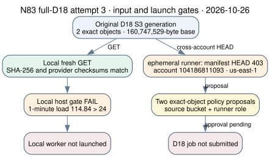

# N83 full-D18 third input and execution preflight

**2026-10-26, primary curve:** `icv1-f2m83-tm6151469093347-debefd74`,
Koblitz `a=0` over GF(2^83), prime subgroup order
`2417851639230796216685689`.

**Observed state:** `INPUT_CUSTODY_PASS`; `LOCAL_CAPACITY_GATE_FAIL`;
`CLOUD_DIRECT_READ_DENIED`; `ON_DEMAND_SMOKE_LAUNCH_DENIED`;
`WORKER_NOT_LAUNCHED`. This is a third fresh
input check for the [frozen native positive-then-natural protocol](../PROTOCOL.md)
and [assignment amendment](../ASSIGNMENT_CERTIFICATE_AMENDMENT.md). The
[access and launch diagram](ACCESS_GATE.svg) shows both checked routes. It
is a process diagram because neither solver arm ran; there are no comparable
algorithm timings. A later infrastructure smoke also failed before instance
allocation. `selected_best_total_runtime` remains `null`.



## Source and input identity

The clean sparse source checkout was `45ce91d503ee0d0acc57e3d8d5cb49108c90ded6`
from [PR #2649](https://github.com/isogeny-labs/crypto/pull/2649). Its
`git status --porcelain` was empty. The release worker and separate verifier,
built earlier from this exact commit, retained SHA-256 respectively
`11220d8b838bf5cac2985dbcba4ea96e69a64b70dc54044d180cf6a3e8970e49`
and `e89578703888568d67f79e5b2645e47b911a30a9d7a8a3d57e795be997296b71`.
Neither binary was launched in this preflight.

Fresh checksum-enabled `aws s3api get-object` calls to the original
`crypto-autoresearcher` bucket fetched the producer-bound custody wrapper
and the full D18 compressed object. SHA-256 of the committed producer
manifest, fresh [S3 wrapper](evidence/s3-manifest.json), and local compressed
object matched, in order:

```text
1d3650eabc4662d8f2597498d7ac92b7cd0a4134ac5f8155aaa49c7af3407dce
1b93351febd47dac4de8c5dd39dbf58564d0057a044054baf448d978f6c0d616
eaef94ef45b3d2d4cd2ec2f40c1173b4cdb2a437b7e618a858c73fb1caf3902b
```

The [wrapper](evidence/manifest-get-metadata.json) and
[object](evidence/object-get-metadata.json) provider responses both report
`ChecksumType=FULL_OBJECT`; the object response reports `ContentLength=160747529`.
The compressed object remains at the immutable S3 key in [AWS_RESUME.md](../../AWS_RESUME.md);
it is not copied into Git. These checks establish the exact fetched bytes,
not relation yield or solver correctness.

## Execution gates

The [local host preflight](evidence/host-preflight.txt) at
`2026-10-26T21:40:48Z` recorded one-minute load **114.84**, versus the
frozen launch maximum **24**. The scratch filesystem reported 40 GiB free,
above the 2 GiB minimum. Because load failed, the local worker was not
launched; this single observation does not measure its potential runtime.
The swapout counter in the receipt is cumulative and is not interpreted as
a run delta because no arm ran.

The repository's deployed [`ephemeral` runner configuration](evidence/ephemeral-config.json) was accessible
through the configured `ecc-challenges-new` AWS profile in account
`104186811093`, `us-east-1`; its instance profile is `ephemeral-runner`.
A `HeadObject` for the original D18 manifest through that profile returned
`403` ([exit](evidence/runner-manifest-head.exit.txt),
[stderr](evidence/runner-manifest-head.stderr.txt)). Read-only IAM inspection
found no exact D18 read in the [runner role](evidence/runner-existing-policy.json),
and the source bucket had [no bucket policy](evidence/source-bucket-policy.stderr.txt).
The
[two-sided exact-read proposal](ACCESS_PROPOSAL.md) records the minimal
source-bucket and runner-role policies for a direct original-object GET.
**Neither proposed policy was applied and no hosted D18 job was submitted.**
The separate previously approved `rho-gh-snapshot-readonly-20261024` user
grant remains a different access path.

The new opt-in `--on-demand` runner path passed the
[Docker-free fake-AWS market test](evidence/market-selection-test.log) and
[eight Rust CLI unit tests](evidence/ephemeral-cli-test.log). A real
`--no-source --toolchain none --on-demand --type t3.small --ttl 20m`
market smoke then created [job receipt](evidence/on-demand-smoke-job.json)
`20261026-215459-n83-ondemand-market-smok-7d2a65`, with `spot:false`,
but its [status](evidence/on-demand-smoke-status.json) is `error` at
`RunInstances`. The CLI error named an explicit deny in IAM policy
[`SpotOnlyEC2Launch` version `v2`](evidence/spot-only-policy-v2.json), whose
first two statements deny non-Spot instance launches outside their stated
Auto Scaling or recovery-template conditions. A
[tag-specific instance readback](evidence/on-demand-smoke-instances.json)
returned `[]`: no EC2 instance was allocated. This attempted smoke did not
fetch D18 input or execute cryptographic code. The exact S3 read proposals
and a separately authorized non-Spot launch path are both needed for the
current hosted plan.

## Outcome and next action

| Requested step | Status in attempt 3 |
|:--|:--|
| Exact S3 input custody | Verified for the fresh local GET, hashes above |
| Constructed cadence-32 SAT and separate assignment replay | Not launched; local host gate failed |
| One public natural query | Not launched; positive gate not passed |
| Hosted direct original S3 fetch | `403` in deployed runner account; exact grant proposed |
| On-Demand runner smoke | `RunInstances` explicit deny; no instance allocated |
| Cold total-runtime selection | Unmeasured; no factor-base winner selected |

The next executable action is either a local host that passes the frozen
load and swap gates, or an authorized deployed runner that can directly GET
the two original S3 objects and meets the frozen host and checkpoint/isolation
requirements. Run one constructed control at its 300-second internal cap,
require separate group and retained-assignment replay if it reaches SAT,
and only then run the one 2,400-second public natural query. Preserve any
cap or infrastructure failure. Natural yield, closure, useful rank, logs,
unseen-target descent, fully charged cold cost, matched rho and finite-grid
coverage remain open. No new algorithm result changes the canonical
performance or boundary graphs.
