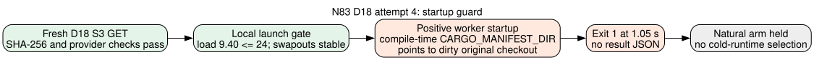

# N83 full-D18 attempt 4: source-bound producer guard

**2026-10-26.** Frozen primary curve `icv1-f2m83-tm6151469093347-debefd74` (Koblitz `a=0` over GF(2^83)); prime subgroup order `2417851639230796216685689`. This attempt follows the [frozen native protocol](../PROTOCOL.md). Outcome: `INPUT_CUSTODY_PASS`, `LOCAL_CAPACITY_GATE_PASS`, `SOURCE_BOUND_WORKER_GUARD_FAIL`, `POSITIVE_NOT_STARTED`, `NATURAL_NOT_STARTED`. The [gate diagram](SOURCE_GUARD.svg) is a process record. It contains no algorithm timing and changes no factor-base ranking.



## Exact input and launch

A fresh checksum-enabled S3 GET yielded the committed producer manifest, S3 wrapper, and compressed D18 object with SHA-256 respectively:

```text
1d3650eabc4662d8f2597498d7ac92b7cd0a4134ac5f8155aaa49c7af3407dce
1b93351febd47dac4de8c5dd39dbf58564d0057a044054baf448d978f6c0d616
eaef94ef45b3d2d4cd2ec2f40c1173b4cdb2a437b7e618a858c73fb1caf3902b
```

The provider [manifest](evidence/manifest-get-metadata.json) and [object](evidence/object-get-metadata.json) receipts give full-object checksums; the object is 160,747,529 bytes. Its immutable S3 location is in the [AWS handoff](../../../aws-resume-handoff-20261025/README.md). The object bytes are kept outside Git.

The [prelaunch receipt](evidence/prelaunch.txt) at `2026-10-26T21:59:15Z` gave one-minute load **9.40** against the frozen maximum **24**, 38 GiB free against the 2 GiB minimum, and cumulative swapouts **1,936,358**. The [decision](evidence/prelaunch-decision.txt) was `GATE_PASS`. The worker invocation used `primary-full-d18-m4-l0-ordered-xor-cadence32 positive`, the frozen `pilot-01` fixture, `gtimeout --kill-after=5s 310s`, and `/usr/bin/time -l`. The release worker and separate verifier SHA-256 were `11220d8b838bf5cac2985dbcba4ea96e69a64b70dc54044d180cf6a3e8970e49` and `e89578703888568d67f79e5b2645e47b911a30a9d7a8a3d57e795be997296b71`.

## Observed failure and correction

The worker returned [exit 1](evidence/result.json.exit.txt) in **1.05 s** of process wall time, with `Error: "v2 construction requires a clean, frozen worktree"` in [stderr](evidence/stderr-time.txt). Its stdout was empty and it emitted no result JSON. The [postrun receipt](evidence/postrun.txt) showed unchanged cumulative swapouts and load **9.40**. The 1.05 s is a startup failure duration, not a decomposition or solver observation.

The source guard at [`examples/koblitz_n83_factor_base_export.rs:562`](https://github.com/isogeny-labs/crypto/blob/45ce91d503ee0d0acc57e3d8d5cb49108c90ded6/examples/koblitz_n83_factor_base_export.rs#L562) resolves `CARGO_MANIFEST_DIR` at **compile time** and then checks that path's Git worktree status. These binaries had been built in the original checkout, which became dirty during unrelated sparse-checkout recovery. Launching them from a different clean checkout cannot change the embedded path. A new release build from clean source commit `45ce91d503ee0d0acc57e3d8d5cb49108c90ded6`, with a fresh Cargo target directory, is required before another source-bound attempt. This diagnosis is from source inspection and the exact guard error; it does not establish anything about the factor base.

| Frozen step | Attempt 4 status |
|:--|:--|
| Original S3 input custody | Verified by fresh GET and exact hashes |
| Host launch gate | Passed |
| Constructed positive and separate assignment replay | Worker guard failed before a result |
| Public natural query | Not launched because the positive gate did not pass |
| Cold total runtime and winner | Unmeasured; `selected_best_total_runtime=null` |

Next: rebuild both release binaries from the clean source checkout, verify its status and both new hashes, then take another fresh input and host preflight before rerunning the bounded positive arm. No new verified finding changes the canonical performance or boundary graphs.
