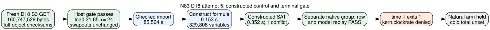

# N83 full-D18 attempt 5: constructed SAT with a timing-wrapper exit mismatch

**2026-10-26, primary curve:** `icv1-f2m83-tm6151469093347-debefd74`, Koblitz `a=0` over GF(2^83), prime subgroup order `2417851639230796216685689`. This write-once attempt uses the [frozen native protocol](../PROTOCOL.md) and [assignment amendment](../ASSIGNMENT_CERTIFICATE_AMENDMENT.md). Its classification is `INPUT_CUSTODY_PASS`, `LAUNCH_GATE_PASS`, `CONSTRUCTED_SAT_AND_REPLAY_PASS`, `TIMING_WRAPPER_EXIT_MISMATCH`, `NATURAL_HELD`. The [timing and gate diagram](CONTROL_TIMELINE.svg) keeps the measured stages separate from the harness failure.

## Frozen identity and controls

The [clean-source build](BUILD.md) used source commit `45ce91d503ee0d0acc57e3d8d5cb49108c90ded6`. Worker SHA-256 was `d15ecfefb86baaf351535a54f5bbcdcd10a4ded39fe3c75c765c67bd4dfe040e`; separate native verifier SHA-256 was `e89578703888568d67f79e5b2645e47b911a30a9d7a8a3d57e795be997296b71`. The worker's [started phase](evidence/positive/result.json.phases.jsonl) reports both the source commit and new worker hash. The checkout was clean before launch.

Fresh checksum-enabled S3 GETs matched the producer manifest, S3 custody wrapper, and complete compressed D18 object SHA-256 respectively `1d3650eabc4662d8f2597498d7ac92b7cd0a4134ac5f8155aaa49c7af3407dce`, `1b93351febd47dac4de8c5dd39dbf58564d0057a044054baf448d978f6c0d616`, and `eaef94ef45b3d2d4cd2ec2f40c1173b4cdb2a437b7e618a858c73fb1caf3902b`. The object is 160,747,529 bytes. The [provider manifest](evidence/manifest-get-metadata.json) and [object](evidence/object-get-metadata.json) receipts report `ChecksumType=FULL_OBJECT`. The immutable S3 key is in [AWS_RESUME.md](../../AWS_RESUME.md). [Hash inventory](evidence/input-sha256.txt) and [custody wrapper](evidence/s3-manifest.json) are retained; the compressed object remains in S3.

The [prelaunch decision](evidence/positive/prelaunch-decision.txt) passed at one-minute load **21.65** against the frozen maximum **24**, stable cumulative swapouts **1,954,566**, and about 38 GiB scratch free. The execution used `gtimeout --kill-after=5s 310s /usr/bin/time -l` around the `primary-full-d18-m4-l0-ordered-xor-cadence32 positive` worker, with the frozen `pilot-01` fixture and fresh D18 base. The source status file was empty.

## Observed constructed control

The [worker result](evidence/positive/result.json), [phase trace](evidence/positive/result.json.phases.jsonl), and retained [model bits](evidence/positive/result.model.bin) record a constructed `Sat` answer with one conflict and selected indices `[0,166,332,498]`. The 329,808-bit model's SHA-256 is `e41a2df1bd8cbf940f04797318f071045bb547e7270991f92f2155979920ee3f`. The worker reports 2,807,999 clauses, 3,901 XOR rows, and 32,643 representatives; it checked the original CNF/XOR assignment. The separate [native replay](evidence/positive/audit-original.json) returned `PASS_NATIVE_GROUP_ROW_AND_ASSIGNMENT_REPLAY`, checking the original curve group sum, signed-orbit row, target control, and retained assignment against reconstructed CNF/XOR and field equations. Its process returned [exit 0](evidence/positive/audit-original.exit.txt).

| Charged or observed item | Value | Boundary |
|:--|--:|:--|
| Full-object import | 85.564 s | Same process, fresh local object |
| Formula construction | 0.153 s | Worker phase value |
| SAT search | 0.352 s | Constructed target only, one conflict |
| Worker process wall | 86.603 s | Internal cap 300 s |
| Worker CPU | 58.545 s | Worker process usage |
| Worker peak RSS | 4,769,202,176 bytes | Worker process usage |
| Outer `/usr/bin/time -l` wall | 87.20 s | Shared Darwin host, L0 |
| Launch/post one-minute load | 21.65 / 41.73 | Host contention changed during run |
| New swapouts during arm | 0 | Cumulative counter delta |

These timings describe this constructed control on a shared host. They do not estimate natural relation yield, cold total IC cost, or a factor-base ordering. `selected_best_total_runtime` and `total_index_calculus_runtime_ms` remain `null`.

## Terminal-exit discrepancy and next gate

The launcher captured [exit 1](evidence/positive/result.json.exit.txt) even though the worker emitted a complete terminal SAT result. Its [stderr](evidence/positive/stderr-time.txt) ends `time: sysctl kern.clockrate: Operation not permitted`. An independent `/usr/bin/time -l /usr/bin/true` control also [exited 1](evidence/positive/time-l-true.exit.txt) with the same error; `/usr/bin/time -p /usr/bin/true` [exited 0](evidence/positive/time-p-true.exit.txt). This attributes the observed wrapper failure to macOS timing-resource inspection, while the child exit in this attempt was not separately captured. The native verifier accepted the result because its terminal path does not check `.exit.txt`; it checks exit 124 only for cap receipts. That is a verifier gate gap, not permission to reinterpret the exit file.

The natural arm was held. The versioned [exit-policy amendment](../EXIT_POLICY_AMENDMENT.md) freezes a `time -p` rerun, explicit terminal exit 0 check, and unchanged input/host/positive/replay gates before one natural query. Its strengthened verifier [rejected this attempt's exit 1](evidence/positive/audit-terminal-exit-reject.stderr.txt) in a separate negative control; its earlier passing replay receipt and raw data are preserved. If the next host gate fails, retain that failure without substituting this attempt's successful model for the missing process-exit proof. No new total-runtime or boundary graph finding follows from this control.
