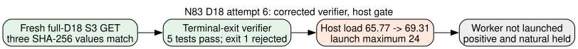

# N83 full-D18 attempt 6: corrected terminal gate, unqualified host

**2026-10-26, primary curve:** `icv1-f2m83-tm6151469093347-debefd74`, Koblitz `a=0` over GF(2^83), prime subgroup order `2417851639230796216685689`. This is a write-once input and execution preflight under the [frozen native protocol](../PROTOCOL.md), [retained-assignment amendment](../ASSIGNMENT_CERTIFICATE_AMENDMENT.md), and [terminal-exit amendment](../EXIT_POLICY_AMENDMENT.md). Its outcome is `INPUT_CUSTODY_PASS`, `TERMINAL_VERIFIER_FIX_TEST_PASS`, `LOCAL_CAPACITY_GATE_FAIL`, `WORKER_NOT_LAUNCHED`. The [gate diagram](CAPACITY_GATE.svg) depicts the actual stop. No algorithm arm was timed in this attempt.

## Frozen input and executable identities

A new checksum-enabled GET fetched the original S3 custody wrapper and 160,747,529-byte D18 object. The committed producer manifest, fresh wrapper, and object SHA-256 respectively matched `1d3650eabc4662d8f2597498d7ac92b7cd0a4134ac5f8155aaa49c7af3407dce`, `1b93351febd47dac4de8c5dd39dbf58564d0057a044054baf448d978f6c0d616`, and `eaef94ef45b3d2d4cd2ec2f40c1173b4cdb2a437b7e618a858c73fb1caf3902b`. Both [manifest](evidence/manifest-get-metadata.json) and [object](evidence/object-get-metadata.json) provider receipts report `FULL_OBJECT` SHA-256 checksums. The [custody wrapper](evidence/s3-manifest.json) and [local hash inventory](evidence/input-sha256.txt) are retained; the object remains at the immutable S3 key in [AWS_RESUME.md](../../AWS_RESUME.md), outside Git.

The worker remains the clean-source `45ce91d503ee0d0acc57e3d8d5cb49108c90ded6` release binary, SHA-256 `d15ecfefb86baaf351535a54f5bbcdcd10a4ded39fe3c75c765c67bd4dfe040e`. The source checkout [status](evidence/source-status.txt) was empty. The separate patched terminal-exit verifier binary SHA-256 is `fd88fe178992a9ae920774a79c872e4ae5d9d1c789044aa0910b3ff4688092ed`, built against the frozen source library from verifier source blob `1290dd0b70bc49ee6d5ab930917532517f396461`. Its [five example tests](evidence/n83-verifier-terminal-exit-test-20261026.log) passed, including missing, nonzero, cap-code and zero terminal exits. The [release build](evidence/n83-verifier-terminal-exit-build-20261026.log) passed. The patched verifier rejected attempt 5's actual exit-1 receipt before producing a new audit; that negative-control failure is preserved in attempt 5.

## Capacity stop

The [three-sample preflight](evidence/host-preflight-series.txt) at `2026-10-26T22:18:07Z`, `22:18:23Z`, and `22:18:38Z` recorded one-minute loads **65.77**, **67.43**, and **69.31**, all above the frozen launch maximum **24**. Cumulative swapouts remained **2,055,311** across the samples; scratch free space was about 43.9 GiB, exceeding the 2 GiB minimum. Because load failed, the constructed worker was not launched. The rise from the earlier attempt's swapout counter occurred outside this attempt's worker; this preflight establishes no solver capacity or relation result.

| Required step | Attempt 6 state |
|:--|:--|
| Original S3 bytes and provider checksums | Verified by fresh GET |
| Clean source and patched verifier identity | Verified; five focused tests pass |
| Host load, swap delta, scratch gate | Failed on one-minute load |
| Constructed positive with `time -p` and terminal exit 0 | Not launched |
| Separate native group, row and assignment replay | Awaiting a new terminal worker result |
| One public natural query | Held by positive gate |
| Cold total-runtime base selection | Unmeasured; `selected_best_total_runtime=null` |

Next, obtain a host that meets the frozen load/swap/scratch gate, repeat a fresh provider-checked input GET and the corrected constructed arm, then require exit 0 and separate native replay before the one public natural query. The deployed AWS runner still needs a separately authorized direct read path and an authorized capacity route. Attempt 5's constructed SAT is evidence for its exact control only; it cannot substitute for this attempt's missing terminal process-exit proof. No canonical performance or boundary graph is changed by this preflight.
