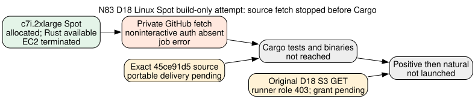

# N83 D18 Linux Spot source-build smoke: private fetch stopped before Cargo

**2026-10-26; write-once infrastructure result.** This was a build-only check of the frozen `45ce91d503ee0d0acc57e3d8d5cb49108c90ded6` source on the deployed `ephemeral` Spot runner, before any D18 input read or cryptographic arm. The [frozen Linux protocol](../LINUX_SPOT_PROTOCOL.md) still governs a later positive/natural pair. The [gate diagram](SOURCE_GATE.svg) shows the observed stop and the independent original-input gate.

## Submitted job and observed result

The job `20261026-223453-n83-linux-source-build-3f79fe` used `taskq/deploy/ephemeral/ephemeral run`, `--spot`, `--instance-type c7i.2xlarge`, `--toolchain rust`, `--ref 45ce91d503ee0d0acc57e3d8d5cb49108c90ded6`, and a 30-minute TTL. Its [exact command](evidence/cmd.sh) checked `git rev-parse HEAD`, then would test and build the worker and independent verifier release examples and hash their binaries. It contained no D18 GET and no worker invocation. The [sanitized job summary](evidence/job-summary.json), [provider status](evidence/status.json), and [job log](evidence/job.log) retain the actual job identity and failure.

| Stage | Observed evidence | Classification |
|:--|:--|:--|
| Spot allocation | `i-0a18ead9d16ae3b5f`, `c7i.2xlarge` in `us-east-1c`; [host receipt](evidence/host.txt) reports 8 logical CPUs, 15 GiB memory and 96 GiB free root filesystem | Capacity admitted at launch |
| Toolchain setup | Runner log reports `rustc 1.99.1` | Reached setup, before Cargo |
| Private source fetch | Cached base restored; both cached and fresh HTTPS fetches failed with `fatal: could not read Username for 'https://github.com': No such device or address` | **Source access failure**; no binary produced |
| Terminal and cleanup | [Status](evidence/status.json) is `phase:error`, `exit_code:null`; [EC2 readback](evidence/instance-readback.json) is `terminated` | Self-termination verified |

The runner's generic reason says `git fetch ... failed (is it pushed?)`. The decisive child error is lack of noninteractive GitHub authentication for this private repository; it does not establish that commit `45ce91d5` is absent. A clean local checkout resolves that exact commit. No Cargo test/build, source-bound binary hash, D18 input read, constructed control, or natural arm happened in this job. Do not retry the same `--ref` fetch path without a source-delivery change.

## Independent no-source Rust route check

The follow-up job [`20261026-230258-n83-rust-no-source-smoke-6513a6`](evidence/no-source-rust/job-summary.json) used `--no-source --toolchain rust` on a self-terminating `t3.small` Spot host with a 20-minute TTL. It deliberately supplied no Git ref and no source archive. The [runner log](evidence/no-source-rust/job.log) proceeded from setup directly to the command, without a Git fetch. The command wrote [Rust](evidence/no-source-rust/rustc.txt) and [AWS CLI](evidence/no-source-rust/aws.txt) versions to S3; [status](evidence/no-source-rust/status.json) records exit 0, and direct [EC2 readback](evidence/no-source-rust/instance-readback.json) confirms `i-004ae3fd3fa3bf2f5` terminated. The [hash manifest](evidence/no-source-rust/sha256.txt) covers the committed raw copies. This verifies the runner route needed to GET and build a package after authorization. It was a seconds-long command and did not test Cargo dependency fetch, archive read, D18 read, worker memory or Spot endurance.

The raw provider records remain at `s3://ephemeral-runs-104186811093-us-east-1/jobs/20261026-223453-n83-linux-source-build-3f79fe/`. The committed copies preserve `status.json`, `job.log`, `host.txt`, and `cmd.sh`; the original `job.json` has SHA-256 `da4760d9baf03a16faa6675639608d3453bbd3164b1601b476347b104bdfadb2` and remains at that S3 key. The [manifest](evidence/sha256.txt) lists exact committed-file hashes. The job summary omits the raw owner field. The EC2 readback confirms termination rather than assuming cleanup from a runner log.

## Source and input gates that remain

The previously approved 17,757,116-byte source archive was fetched back from its [custody URI](../../AWS_RESUME.md) with provider `FULL_OBJECT` checksum metadata. Its [fresh readback receipt](evidence/old-source-archive-readback.json) matches SHA-256 `e679260bd849fed12f3588a57643277547b969399ab576a4883668821dabb3e4`, but its metadata freezes source `54cbef1a6ce834a77632c1867acc801a31268ca2`, and its 3,260 archive entries contain no `.git` metadata. It predates this cadence-32 worker and cannot satisfy the Linux protocol's exact `45ce91d5` clean-source check. This is an identity mismatch, not a corrupt archive.

The deployed `ephemeral-runner` role also still lacks the separately required read from the **original** D18 S3 bucket; its earlier direct manifest read returned `403`. The [reviewed two-sided exact-object proposal](../attempt-3/ACCESS_PROPOSAL.md) has not been applied. The active `N83D18ExactInputRead20261025` grant is on a different IAM user and does not fix this role. Any new source archive or credential route needs its own reviewed authorization and exact provenance. The frozen pair should start only after source delivery, original-object permissions, provider checksums, clean source/binary identities, and per-job launch lock all pass.

An [exact-commit sparse source archive and three-object read proposal](SOURCE_DELIVERY_PROPOSAL.md) is now prepared locally. Its fresh extraction passed 20 worker and 5 patched-verifier release example tests offline, but the archive has **not** been uploaded and its temporary cross-account permissions have **not** been applied. The proposal supersedes the unapplied two-object proposal only if explicitly authorized after review.

## Claim and graph disposition

This result verifies live Spot allocation, a Rust-capable image, a private-fetch failure and EC2 cleanup for one build-only job. It provides no algorithm timing or factor-base ordering. `selected_best_total_runtime` remains `null`. No canonical performance graph changes: no performance datum was produced. The local archive GET and this hosted job are separate checks, and no cross-host cost ratio is inferred.
