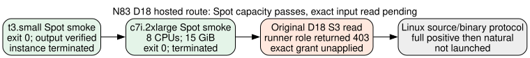

# N83 hosted Spot capacity smoke and remaining input gate

**2026-10-26.** Two self-terminating no-source jobs were submitted through the repository's `taskq/deploy/ephemeral/ephemeral` runner using configured AWS profile `ecc-challenges-new`, account `104186811093`, `us-east-1`. They check live Spot admission, remote command execution, S3 output and instance cleanup for a possible full-D18 N83 host. They contain no cryptographic source or D18 object and do not measure the index-calculus worker. The [capacity and access diagram](SPOT_GATE.svg) distinguishes the now-verified Spot route from the original-object read gate.

## Exact smoke commands and provider receipts

Both jobs used `ephemeral run --spot --toolchain none --ttl 20m --no-source --detach` with a `printf` command writing `market.txt` to `$EPHEMERAL_OUT`; only instance type, job name and expected marker differed. The repository CLI's TTL and runner self-termination are the safety bounds. No source snapshot was attached.

| Job | EC2 instance and host | Command/output | Final provider state |
|:--|:--|:--|:--|
| [`20261026-222409-n83-spot-market-smoke-72bebc`](evidence/small/job-summary.json) | `i-0ce8badaf1423d7b0`, `t3.small`, 2 logical CPUs | [`spot-ok`](evidence/small/market.txt), exit 0 in [status](evidence/small/status.json) | Spot, terminated in [EC2 readback](evidence/instance-states.json) |
| [`20261026-222556-n83-spot-16g-smoke-90f1a3`](evidence/large/job-summary.json) | `i-0c37e5d0253a5d4d3`, `c7i.2xlarge`, 8 logical CPUs, 15 GiB reported by [host](evidence/large/host.txt) | [`spot-16g-ok`](evidence/large/market.txt), exit 0 in [status](evidence/large/status.json) | Spot, terminated in [EC2 readback](evidence/instance-states.json) |

The [small](evidence/small/job.log) and [large](evidence/large/job.log) logs show boot, setup, command exit, upload, done and termination; [resource receipts](evidence/large/rusage.txt) cover the smoke command only. Full raw job specs remain at `s3://ephemeral-runs-104186811093-us-east-1/jobs/<job-id>/job.json`, SHA-256 `ac2c111374fffa78d17b10645435933bbba91b14748b6b3eb194696b99202237` for small and `a448d56c0b0453aa16b0f1c39928b1055a9ad0fafa9f389b9889156f46dd5da9` for large. The committed job summaries omit the owner field. Raw host/status/output bytes are copied alongside this report; S3 retains the original job records.

The larger instance has reported memory above attempt 5's **4,769,202,176-byte** constructed worker peak RSS. That comparison is a capacity lead, not proof that a full Linux worker or 2,400-second natural query can complete on Spot: this smoke ran for seconds, installed no Rust toolchain, read no D18 data and had no interruption notice. The no-checkpoint solver remains exposed to Spot reclamation; its exact failure would have to be retained if interrupted.

## Remaining hosted execution conditions

The deployed runner role's direct read of the original D18 manifest returned `403` in the earlier [attempt-3 access audit](../attempt-3/REPORT.md). The [reviewed exact two-sided bucket/role proposal](../attempt-3/ACCESS_PROPOSAL.md) is unapplied pending the separate user authorization. The already active exact-object grant on `rho-gh-snapshot-readonly-20261024` is for another IAM principal and does not grant this runner role access. The account's `SpotOnlyEC2Launch` policy explicitly denied a direct On-Demand smoke in attempt 3; these successful Spot launches do not alter that restriction.

For a hosted D18 experiment, first obtain and read back the exact runner/bucket S3 permission, then follow the separately frozen [Linux Spot protocol](../LINUX_SPOT_PROTOCOL.md), including its per-job immutable binary/host launch lock before timing. Fetch and verify the original wrapper and object with provider checksums from the runner; apply the positive exit-0, native group/row/assignment, and natural gates from the [current amendment](../EXIT_POLICY_AMENDMENT.md), with explicit Spot interruption classification. Record a separate Linux host baseline and charges. No such job was submitted by these smokes, and `selected_best_total_runtime` remains `null`. No canonical performance graph changes because these are infrastructure checks only.
