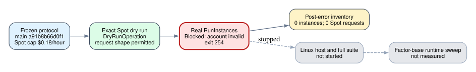

# Attempt 1: AWS Spot capacity admission stopped

**Status:** stopped before a host or test process existed. This is the result
of the [precommitted protocol](../PROTOCOL.md) at `a909de2a13a1`. The
target library source was merged `main`
`a91b8b66d0f1ffc175fdce984d1059144ce232f6`. This attempt measured no
library-test outcome, factor-base construction, relation yield, rank, descent,
or IC runtime.

## Observations

| Gate | Observation |
| --- | --- |
| AWS identity | `ecc-challenges-new` resolved to IAM user `coreuser` in account `104186811093`. No credential was sent to a host. |
| Spot capacity request | One `c7g.2xlarge`, `us-east-1f`, AMI `ami-061bb79b9c35a0b94`, 150 GiB `gp3`, `MaxPrice=0.18` USD/hour, 225-minute automatic shutdown backstop. |
| Exact Spot dry run | Exit 254 with `DryRunOperation`: request would have succeeded with the dry-run flag. This checks authorization shape, not account acceptance or capacity. |
| Real `RunInstances` | Exit 254 with service error `Blocked`: “This account is currently blocked and not recognized as a valid account.” No instance ID, Spot request ID, or volume ID was returned. |
| Post-error inventory | `DescribeInstances` filtered by run tag returned zero rows; `DescribeSpotInstanceRequests` with the same tag returned zero rows. Both reads exited 0. No instance was observed and no volume ID was returned for cleanup. |
| Test and cleanup | Docker build, public source clone, fixture transfer and release-library command did not start. There was no identified EC2 resource to terminate. |

The observed Spot price query for `c7g.2xlarge` in `us-east-1f` returned
`0.123300` USD/hour at `2026-11-16T10:00:00Z`; this is a capacity-planning
observation, not a charge or IC cost. The account block occurred after a
positive dry run, so a dry-run pass is insufficient as an instance gate.
The exact API start/end timestamps were not captured in the local shell
receipt. The blocked result and zero-row post-error inventories were observed
by `2026-11-16T12:17:48Z`; no tighter wall interval is claimed.

## Exact request and retained error

The dry run used the same request with `--dry-run` added. The real request
was:

```sh
aws ec2 run-instances --region us-east-1 --profile ecc-challenges-new \
  --image-id ami-061bb79b9c35a0b94 --instance-type c7g.2xlarge \
  --subnet-id subnet-0c343d40111cce085 \
  --security-group-ids sg-0b3da730791ffdefc --key-name meow34 \
  --associate-public-ip-address \
  --block-device-mappings 'DeviceName=/dev/xvda,Ebs={VolumeSize=150,VolumeType=gp3,DeleteOnTermination=true}' \
  --instance-market-options 'MarketType=spot,SpotOptions={SpotInstanceType=one-time,InstanceInterruptionBehavior=terminate,MaxPrice=0.18}' \
  --instance-initiated-shutdown-behavior terminate \
  --user-data file://research/koblitz_n83_factor_base_sweep_20261008/verification/k600-aws-spot-full-fixture-20261116/user-data.sh \
  --tag-specifications 'ResourceType=instance,Tags=[{Key=Project,Value=N83FactorBaseSweep},{Key=Run,Value=FullFixtureValidation20261116}]' \
  --count 1 --query 'Instances[0].[InstanceId,State.Name,LaunchTime,BlockDeviceMappings[0].Ebs.VolumeId,SpotInstanceRequestId]' \
  --output text
```

The executed `--user-data file://` argument was the absolute path to the
same committed `user-data.sh` bytes in the local worktree. AWS returned:

> An error occurred (Blocked) when calling the RunInstances operation: This account is currently blocked and not recognized as a valid account.

No alternate region, account, instance type, purchase mode, or provider was
used to retry this frozen attempt. CloudTrail `LookupEvents` for
`RunInstances` over 12:15–12:19 UTC returned zero rows at the immediate
post-error check; this is not evidence that the rejected API call did not
occur, and it supplies no request ID or tighter timestamp.

## Consequence and exit criterion

The exact merged-head Linux validation remains **unrun**. To repeat this
capacity gate, first obtain a confirmed unblocked AWS account or another
qualified ARM64 host, freeze a new host/source/input packet, and verify the
resource envelope and fresh checkout before the library test. The local
macOS full library result remains red (6,413 passed, 17 failed, 135 ignored)
and is not replaced by this attempt. Applicable PR CI and review gates are
independent of this account response. The requested factor-base sweep and
minimum cold one-target IC runtime remain unresolved.

The existing [N83 selection obstruction record](https://github.com/isogeny-labs/crypto/blob/main/problems/n83-mixed-orbit-factor-base-selection.md)
already tracks hosted capacity and access gates. Conductor task T-6315
currently reserves that file and its index for an unmerged update; this
write-once attempt record retains the new account response until that scope
is released. It is not a substitute for the requested experiment.

There is no quantitative algorithm result to add to the canonical IC graphs.
The [admission diagram](admission.svg) shows the gate reached and the
unexecuted downstream stages; its [source](admission.dot) and the
[inspected PDF](REPORT.pdf) accompany this receipt.

{width=6.5in}
