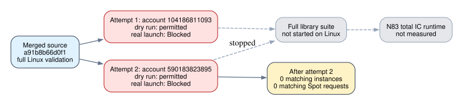

# Attempt 2: alternate AWS account also blocked

**Status:** stopped before instance allocation. The [frozen attempt-2
protocol](PROTOCOL.md) was committed at `6aee825cccfb` before the single
real launch request. It changed only the account-specific capacity route
from [attempt 1](../attempt-1/RESULT.md). The library source target remained
merged `main` `a91b8b66d0f1ffc175fdce984d1059144ce232f6`; no checkout,
Docker process, or library test was started.

## Observed sequence

| Gate | Observation |
| --- | --- |
| Account | `ecc2k130`, IAM user `adam`, account `590183823895`. This is a distinct configured account from attempt 1. |
| Host | One `c7g.2xlarge` Spot request in `us-east-1f`, 150 GiB `gp3` root, `MaxPrice=0.18` USD/hour, existing restricted SSH group and fixed idempotency token. |
| Exact dry run | With the client token and attempt-2 tag, exit 254 `DryRunOperation`: request shape permitted. |
| Real launch | [Started](started.utc) `2026-11-16T12:30:04Z`; [ended](ended.utc) `12:30:05Z`; [exit code](exit.code) 254. AWS returned `Blocked`: the account is currently blocked and not recognized as valid. The full [stderr](run-instances.stderr) is retained; [response JSON](run-instances.json) is empty. |
| Post-error inventory | Read-only `DescribeInstances` by client token and by run tag each returned zero rows; `DescribeSpotInstanceRequests` by run tag also returned zero rows. All three reads exited 0. No instance, Spot request or volume ID was returned for cleanup. |
| Input precheck | The pinned archived targetwalk fixture was freshly downloaded locally through `ecc-challenges-new`; 2,293,097 bytes and its pinned SHA-256 matched. The current SSH source IP matched the existing `/32` rule. Nothing was transferred to a host. |

The exact fresh-download [SHA-256 receipt](fixture.sha256) and
[byte-count receipt](fixture.bytes) retain the full digest and source path;
the parent protocol pins the same digest and S3 object key.
The post-error [client-token instance response](instance-by-client-token.json),
[run-tag instance response](instance-by-run-tag.json), and
[Spot-request response](spot-by-run-tag.json) preserve the empty JSON arrays;
their later [readback time](inventory.checked.utc) is separate from the
12:30:04–12:30:05 UTC launch interval.

The single request was issued through committed [`launch.sh`](launch.sh) with
client token `n83-full-fixture-20261116-attempt2` and run tag
`FullFixtureValidation20261116Attempt2`. Its raw receipts above distinguish
an API rejection from a Spot interruption or a compiler failure. The account
block happened after a positive dry run, as in attempt 1. Neither dry run
establishes that the account can allocate an instance. No identified
resource required termination, and no test output or IC timing exists.

## Next gate and claim boundary

Both configured AWS accounts used here returned the same account-level
`Blocked` response at real `RunInstances`, despite positive exact dry runs.
Do not repeat unchanged launches. The account owner must resolve the service
block, or provide a separate qualified ARM64 host and access route; a new
versioned packet must bind that host before execution. The 12 GiB/no-swap,
four-CPU Linux validation, full fixture, exact merged source and terminal
library result remain open. The prior macOS suite remains red at 6,413
passed, 17 failed and 135 ignored; it is not replaced by either stopped
capacity attempt.

This is an access and account-state blocker, not a mathematical obstruction
or a factor-base comparison. It supplies no relation rate, useful rank,
target solve, matched rho, or minimum cold IC runtime. The existing
[N83 selection problem record](https://github.com/isogeny-labs/crypto/blob/main/problems/n83-mixed-orbit-factor-base-selection.md)
tracks the hosted-capacity obligation; its write scope is held by Conductor
task T-6315, so this new result is linked here until that scope is released.
No canonical IC graph changes because no graphable algorithm result was
produced.

The [source diagram](admission.dot), [SVG](admission.svg), [PNG](admission.png)
and [inspected PDF](REPORT.pdf) show the two separate admissions and the
unexecuted library/IC stages.

{width=6.5in}
