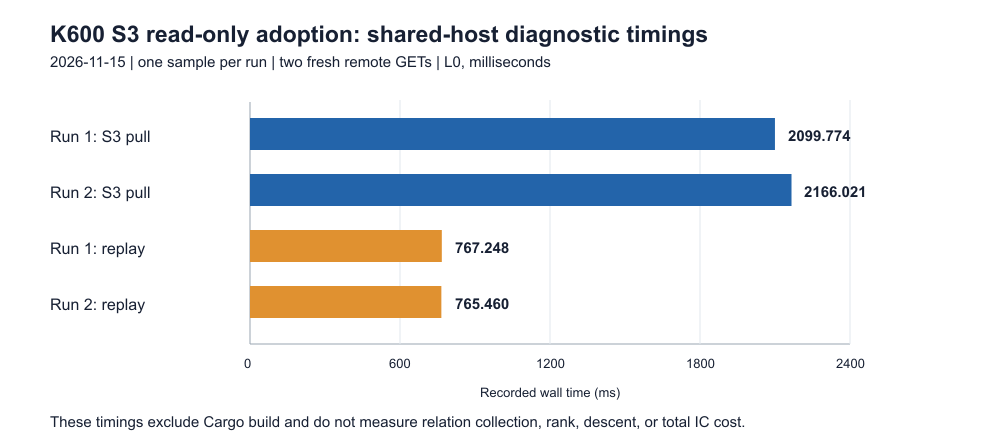
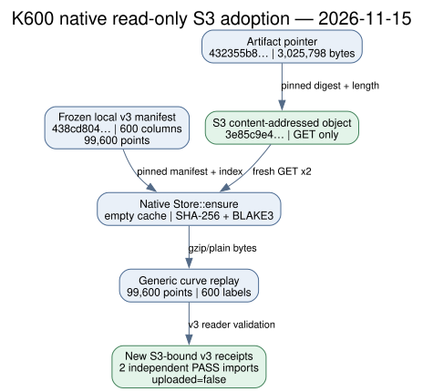

# K600 native read-only S3 adoption — 2026-11-15

**Result.** The exact 600-column primary `a=0` signed-Frobenius base for `icv1-f2m83-tm6151469093347-debefd74` was fetched from `s3://setec-astronomy-artifacts/store` twice into separate empty caches. Both native v3 imports returned `PASS`; each checked 99,600 curve points and 600 orbit representatives. This is a factor-base custody and reader result. `selected_best_total_runtime` remains `null` because relation collection, linear algebra, target descent, and matched rho were not measured here.

## Frozen inputs and method

The [protocol](PROTOCOL.md) and [execution lock](EXECUTION_LOCK.json) preceded the S3 runs. Native implementation commit: `1bcf8308d007`; executed clean checkout commit: `115dfec5ef4a`. The frozen input hashes, logical store name and complete command are in the lock. The original local v3 [manifest](../k600-v3-local-custody-20261115/attempt-1/manifest.json), [artifact pointer](../k600-v3-local-custody-20261115/attempt-1/objects/.artifacts.json), and store index were checked against the pinned SHA-256 values before output creation. The compressed object was 3,025,798 bytes; the uncompressed base was 14,951,450 bytes.

Host: local Darwin arm64, shared-host L0; Rust 1.99.1; AWS profile `ecc-challenges-new` resolved to account `104186811093` user `coreuser`. Each native command had a 300-second process cap and an internal 300-second adoption cap. It called `Store::ensure` and never called `Store::push`. The new receipts explicitly say `custody_mode=read_only_adoption` and `uploaded=false`. This did not grant a writer identity or perform a PUT. The exact S3 key is in the execution lock.

## Observations

| Run | Import | S3 pull (ms, L0) | Replay (ms, L0) | Process (ms, L0) |
| --- | --- | ---: | ---: | ---: |
| [attempt-1](attempt-1/import.json) | PASS | 2099.774 | 767.248 | 2907.904 |
| [control-2](control-2/import.json) | PASS | 2166.021 | 765.460 | 2973.111 |

Each run checked 99,600 points and 600 representatives. Both fresh GETs matched the exact pinned SHA-256 and 3,025,798-byte length.

The first run's `cargo run` wrote a completed `PASS` import and its stdout, but the zsh wrapper then tried to assign the reserved variable `status` and exited 1; it did not record the child exit. Its [wrapper receipt](attempt-1/wrapper-error.txt), [stdout](attempt-1/stdout.log), [stderr](attempt-1/stderr.log.gz), and completed JSON files are retained. The corrected second run used a separate empty cache and captured exit 0 in [control-2/exit.code](control-2/exit.code). Both `storage.json` receipts record `uploaded=false` and matching remote SHA-256/bytes. No cap or failure JSON was produced by either application run.

The native release example suite passed 27/27, including positive transfer and changed-manifest, changed-pointer, changed-index and changed-remote rejection controls; see [example-test.log](example-test.log). The required root release-library suite was rerun on this checkout: exit 101, 6,306 passed, 59 failed, 138 ignored in 562.90 seconds. Its [full log pointer and verified readback](ARTIFACT_READBACK.md), [exit receipt](lib-test.exit), and [exact failure names](lib-failures.txt) are retained. The sorted failure-name SHA-256 `f93f2816e91fda5d07e0205251d10121646bfa416da3e5e721a9ae9ca7f90356` matches three earlier same-worktree root runs (`n83-v3-producer`, `n83-lib-onequery`, `n83-v3-trial`); the new diff contains no `src/`, `Cargo.toml`, or `Cargo.lock` changes. This root gate remains red and is not counted as passing validation. The tracked [timing data](timings.csv) are single shared-host diagnostics; no ratio is used to select a factor base.

The diagram source is [custody.dot](custody.dot); the [vector diagram](custody.svg), [vector timing graph](timings.svg), and PNG renders are generated from the retained sources/data. The rendered report is [RUN_REPORT.pdf](RUN_REPORT.pdf).

## Scope and next gate

This verifies native S3 **read** acceptance for the archived K600 bytes. Native S3 **writer** acceptance is still open because the bot-uploaded object lacks the SHA-256 user metadata required by `Store::push` for idempotent adoption. The frozen K600 m6 positive/natural relation pair, full-D18 host/input gate, matrix rank, target descent, total cold runtime, and same-target rho remain separate work. The [obstruction record](../../../../problems/n83-mixed-orbit-factor-base-selection.md) tracks those gates. Existing IC scoreboard and progress graphs were checked conceptually and left unchanged because this custody run supplies no relation or total-cost row.
