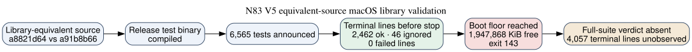

# V5 equivalent-source release-library validation, censored at disk floor

**Observed:** the frozen [validation launcher](run-full-lib.sh) started
`cargo test --release --lib --locked --offline -j 1` on the full-fixture
macOS ARM64 checkout at `a8821d64550526c3151eca205a9751ca4d8aa8a5`.
The diff from merged `a91b8b66d0f1ffc175fdce984d1059144ce232f6`
was empty over `src Cargo.toml Cargo.lock tests gpu tools`. The V5 branch also
leaves those paths unchanged. This is a library-equivalent-source run, **not**
an exact V5-head test. The test process ended with exit **143** after its
declared boot-space floor was crossed. There is no full-suite verdict.

| Item | Recorded value | Evidence |
|---|---|---|
| Host and compiler | shared Darwin arm64; Rust 1.99.1 | [protocol](VALIDATION_PROTOCOL.md), launcher |
| Interval | 2026-11-16 13:16:30–13:36:01 UTC; 19m31s by endpoints | [`start`](full-lib.start.utc), [`end`](full-lib.end.utc) |
| Planned tests | 6,565 | [`full-lib.log`](full-lib.log), `running 6565 tests` |
| Terminal lines before stop | 2,462 `ok`, 46 `ignored`, zero `FAILED` lines; **4,057 without terminal lines** | [`full-lib.log`](full-lib.log); derived remainder `6565 - 2462 - 46` |
| Stop | boot available 1,947,868 KiB, below 2,097,152 KiB floor; SSD available 3,434,820 KiB at stop; child exit 143 | [`disk samples`](full-lib.disk.tsv), [`stop marker`](full-lib.disk-stop.txt), [`exit`](full-lib.exit.txt) |

The raw log is 259,693 bytes, SHA-256
`66e7ffcb926ba1310749e459a241694e576fb2e20acb0eec3ce999ea1e1e0106`.
The disk series is SHA-256
`d1dbed6917e0c28981a4ffb570c5f4b6e32e76d963d222c7cc5fbfd149af519b`;
its minimum recorded boot free space was 1,947,868 KiB and minimum SSD free
space was 3,153,416 KiB. The watcher sent TERM when the boot floor was crossed.
The log has no `test result:` summary, so the observed terminal lines are not
a passing or failing suite count. The cause of the boot-space drop within
the shared host is not established by this receipt.

The earlier [merged-source macOS validation](../k600-budget-v3-contract-20261116/MERGE_VALIDATION.md)
completed with 6,413 passed, 17 failed, and 135 ignored. That is a separate
run and remains a failed gate. This censored run does not overwrite or pool
with it. A qualified full-fixture Linux ARM64 run at the frozen merged source
is still unrun after two AWS account-level admission blocks in
[PR #4420](https://github.com/isogeny-labs/crypto/pull/4420). Neither run
measures a factor-base relation, rank, target logarithm, matched rho, or cold
IC total. The canonical IC graphs remain unchanged.

[DOT](full-lib-flow.dot) · [PNG](full-lib-flow.png) ·
[inspected PDF](full-lib-report.pdf) · [PDF source](full-lib-report.typ).
