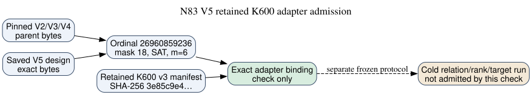

# Retained K600 V5 composed-adapter admission

**Observed:** the exact read-only binding check passed. The native receipt is
[`binding.stdout`](binding.stdout), schema `n83.v5-retained-adapter-binding/v1`,
status `PASS_EXACT_ADAPTER_BINDING`. This admits one implementation route; it
does not report relation yield, rank, target work, or a cold IC runtime.

| Item | Observed value | Evidence |
|---|---|---|
| Source and command | `cdc078c51511d97a1320d11a9be210cd816064ee`; frozen [`run-binding.sh`](run-binding.sh) | [`binding.source-commit.txt`](binding.source-commit.txt) |
| Host and compiler | shared Darwin arm64; Rust 1.99.1 | `uname -sm`; frozen compiler path in launcher |
| Endpoint interval | 2026-11-16 13:14:43–13:14:57 UTC, 14 seconds at one-second resolution | [`start`](binding.start.utc), [`end`](binding.end.utc) |
| Exit | 0 | [`binding.exit.txt`](binding.exit.txt) |
| V5 address | ordinal `26960859236`, single base index 92, mask 18 | [`binding.stdout`](binding.stdout) |
| Solver mapping | `m=6`, split 0, SAT, binary, zero large primes, one thread, modular BigUint LA | [`binding.stdout`](binding.stdout) |
| Retained object | compressed SHA-256 `3e85c9e419fcddd3c9faed3c84470bf96fcad9178e48e1d73629369335841ecf`, 3,025,798 bytes, astronomy artifact store | [retained manifest](../k600-v3-s3-adoption-20261115/attempt-1/manifest.json) and [`binding.stdout`](binding.stdout) |
| Touched release examples | exporter 30/30; standalone V5 2/2 | local `cargo test --release --locked --offline -j 1 --example ...` exits 0 |

The native decoder checked the frozen V2/V3/V4 parent hashes and regenerated
V5 bytes before decoding. The exporter required the exact source, selected
axis values, primary curve ID, and retained manifest. The unit test also
rejected the adjacent ordinal. The raw standard output is 960 bytes,
SHA-256 `53bc33c93ea59c4bef28199135a3162077101736fb2a6eab24a7a6f23c08baa0`;
standard error is 13,477 bytes, SHA-256
`a0377145f394b82d4df5f3eff5ea75588851c0887922a5ad853498301cff0a98`.
The latter contains inherited compiler warnings and the macOS strip-helper
warning; the command exited 0.

The 14-second interval is a warm compile and admission observation on a shared
host. It is **not** an IC cost comparison. This check made no S3 request and
did not invoke the solver. The cold route still requires the separate frozen
host, input, cumulative setup, positive-control, and validation gates. The
selected best total runtime remains null. The canonical IC scoreboard,
progress timeline, and performance charts were checked and left unchanged:
this admission has no graphable algorithm timing or completed comparison.

[Diagram source](binding-flow.dot) · [PNG](binding-flow.png) ·
[inspected PDF](binding-report.pdf) · [PDF source](binding-report.typ) ·
[frozen protocol](PROTOCOL.md).
