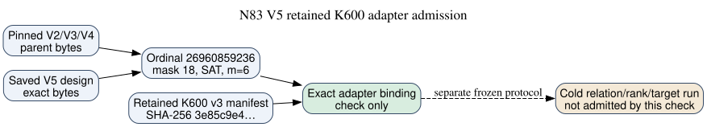

# N83 V5 retained K600 binding, second admission

**Observed:** status `PASS_EXACT_ADAPTER_BINDING` at revised source
`804b1389c2fd624943a7cfc8b5034461f75c9ccf`. The
[thread-gate amendment](../THREAD_GATE_AMENDMENT.md) and
[launcher](../run-binding-attempt-2.sh) were committed before this check. The
first [binding result](../RESULT.md) remains unchanged.

| Field | Recorded value | Raw evidence |
|---|---|---|
| Host/toolchain | shared Darwin arm64, Rust 1.99.1, `RAYON_NUM_THREADS=1` | launcher |
| Interval | 2026-11-16 13:37:11–13:37:26 UTC, 15 seconds at one-second resolution | [`start`](start.utc), [`end`](end.utc) |
| Exit | 0 | [`exit.txt`](exit.txt) |
| Exact cell | V5 ordinal `26960859236`, K600 base index 92, mask 18, ordered-orbit chained SAT | [`stdout`](stdout) |
| Retained object | 3,025,798-byte object, SHA-256 `3e85c9e419fcddd3c9faed3c84470bf96fcad9178e48e1d73629369335841ecf` | [`stdout`](stdout), [manifest](../../k600-v3-s3-adoption-20261115/attempt-1/manifest.json) |

The raw `stdout` is 960 bytes with SHA-256
`53bc33c93ea59c4bef28199135a3162077101736fb2a6eab24a7a6f23c08baa0`.
The raw `stderr` is 13,477 bytes with SHA-256
`a701809280338f45ce76c3a5c4f4ed00d445a91abdcdbb3e671d38b07716a387`.
The revised exporter example suite passed 30/30, including `1`, absent, and
`4` values for its pure one-thread gate. The standalone V5 suite passed 2/2.
The run made no S3 request and invoked no solver. The one-thread environment
value for a future cold route is checked before its run directory is created;
actual future host thread count and cgroup remain to be checked on that host.

The 15-second endpoint interval includes warm compilation and admission and
is not a cold IC timing. Relation yield, rank, target phase, matched rho, and
the selected total-runtime factor base remain unmeasured. No canonical IC
graph changed because this run adds no graphable algorithm result.

[DOT](binding-flow.dot) · [PNG](binding-flow.png) ·
[inspected PDF](run-report.pdf) · [PDF source](run-report.typ).
