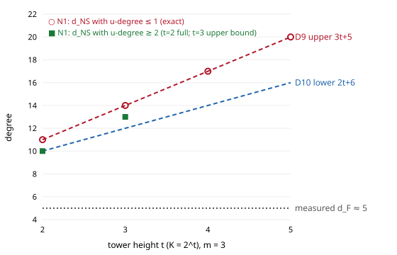

# Kummer m = 3: how far the no-fall degree sits from d_F (2026-11-15)

Status: research note. There is no `pcc` claim, so every number below is `[pcc:unverified]`. Everything ran locally on 4 vCPU.
D9 and D10 are stated and proved in `research/prime_fall_degree_20261027/DERIVED.md`. `[pcc:unverified]`

## Question

For the S3 chain on Kummer towers at m = 3 (towers of height t, K = 2^t), how large is the
**no-fall degree** `d_NS` compared with the last fall degree `d_F`? `d_NS` is the Nullstellensatz degree in the tower ring R, the proof system of D4.

## Results

| t | D10 lower `2t+6` | N1 `d_NS` (any u-degree) | N1 `d_NS` (u-degree ≤ 1) | D9 upper `3t+5` | measured `d_F` |
|---|---|---|---|---|---|
| 2 | 10 | **10** (6/6) | 11 | 11 | ≈ 5 |
| 3 | 12 | ≤ 13 (u-degree caps 2–4) | 14 | 14 | ≈ 5 |
| 4 | 14 | not computed | 17 | 17 | – |
| 5 | 16 | not computed | 20 | 20 | – |

- **D9 (upper bound, proved).** The pointwise Bézout multipliers, summed with the grid indicators, give `d_F ≤ d_NS ≤ 3t+5`. `[pcc:unverified]`
  - Checked independently on 24/24 instances. The identity is verified by explicit multiplication in `F_p[z]/(z^K−1)[u]`.
  - Within its own class (u-degree ≤ 1 multipliers) the bound is exact: N1 measures 3t+5 at t = 2…5.
- **D10 (lower bound, proved, with a condition checked per instance).** An explicit dual functional `[pcc:unverified]`
  `λ(g) = Σ_x x1·x2·x3·⟨u⟩(g·f1⁻¹ mod f2)` kills every column of degree ≤ 2t+5. So `λ(1) ≠ 0` gives `d_NS ≥ 2t+6`.
  - Certified on 32/32 valid instances (three primes, t = 2…5). The lead came from `NEW_LEADS.md` (KM3-LQR-NS); 2t+5 was sharpened to 2t+6.
- **N1 (measurement).** Multipliers of u-degree 2 bring `d_NS` down to 3t+4 at t = 2 and 3.
  - At t = 2 this meets D10 exactly (10 = 2t+6), so **D10 is tight at t = 2** and D9 is not tight for `d_NS`.
  - Controls passed:
    - m = 2 reproduces `2t+2` on 24/24 instances (D4);
    - planted roots are rejected;
    - an explicit product matches the pointwise columns.

## Reading

- At m = 3 the no-fall degree grows linearly: `2t+6 ≤ d_NS ≤ 3t+5`. Measured `d_F` stays near 5.
  - As at m = 2, the fall mechanism accounts for everything above a constant.
- Nothing here bounds `d_F` from below. The open item in DERIVED.md, "no growing lower bound on d_F", stands.
- Not an improvement in cost. The success criterion concerns the IC baseline, and this changes no cost estimate or leaderboard row. `[pcc:unverified]`

## New leads (NEW_LEADS.md), ranked by information per CPU-hour

1. **KM3-LQR-NS**: done here (D10).
2. **KM3-SPEC-LADDER**: specialisation lemma `d_F(m) ≥ d_F(m−1, target ρ)`. It would lift any m = 2 lower bound to every m. It needs a `--target-xr` flag in `pkm_tower_pilot`.
3. **KM3-LQR-CLOSURE**: is `λ`, taken modulo `f2`, a closure pseudo-solution, i.e. is `d_F^{(f2)} = d_F`? It needs `hky_fp_tower::closure` to expose its echelon rows. **This is the step that could turn D10 into a bound on `d_F`.**
4. **KM-ART-DEGEN**: replace `y_{t−1}² = 1` by `= 0` (an Artinian Gorenstein ring). Does `d_F` change?
5. **KM-POPCODE-STEPS**: a code-theoretic explanation of the period-4 steps in `d_F(t)`.

## Files

- `PROTOCOL.md`: N1, frozen before data, sha256 `b790f8bd…`.
- `ns_degree.py`, `run_all.py`, `extra_t2.py`, `extra_t3.py`, `aggregate.py`, `raw/`, `table.json`, `RESULTS.md`: N1.
- `lqr/`: the D10 checks (`lqr_exhaustive.py`, `lqr_check.py` and their logs).
- `NEW_LEADS.md`: the proposals.
- `figures/`: `bounds_vs_measured.svg` (this page) and `ns_degree.svg` (N1).
- `REPORT.pdf`: this page rendered.

Sources checked: research-kb unavailable in this session (no MCP server), so there are no `source_id` receipts. Read directly:
- `research/prime_fall_degree_20261027/DERIVED.md`
- `research/lfd_lower_bound_20261111/NOTE.md` §6
- `research/notes/index-calculus/PRIME_FIELD_IC_CLOSURE_20261112.md` §3.5–4
