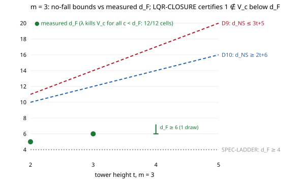

# Kummer wave 2: the four remaining m = 3 leads (2026-11-15)

Status: research note. There is no `pcc` claim, so every number below is `[pcc:unverified]`. All runs were local, on one core per lab.
The leads come from `research/kummer_m3_ns_degree_20261115/NEW_LEADS.md`.

The Rust engine (`pkm_tower_pilot`, `hky_fp_tower`) does not build offline in this container (missing `aws-credential-types`). Every lab therefore used an independent Python closure. Each one reproduces the committed Rust `d_F` values; the details are in each lab's RESULTS.md.

| lead | question | outcome |
|---|---|---|
| **KM3-LQR-CLOSURE** (`KM3-LQR-CLOSURE/`) | Is the D10 functional λ a *closure* pseudo-solution, i.e. `λ(V_{F,c}) = 0` for every `c < d_F`? | **Held on every cell run**: 12/12 m = 3 cells (t = 2, 3), 28/28 m = 2 controls, and `d_F^{(f2)} = d_F`. A λ from another draw fails to vanish (negative control). At t = 4 (one draw) `d_F = d_F^{(f2)} = 6` and λ vanishes on V_c for every `c ≤ 5`, so the prediction holds there too. `[pcc:unverified]` |
| **KM3-SPEC-LADDER** (`KM3-SPEC-LADDER/`) | Lemma P: specialising `z3 ↦ x3, u ↦ ρ` cannot raise the degree, so `d_F(m) ≥ d_F(m−1, ρ)`. | Written as a prose argument modelled on D6 (`[pcc:unverified]`). It held on 50/50 testable pairs. **Uninformative as a bound:** the specialised m = 2 systems have `d_F = 4` for every ρ at t ≤ 5, roots and non-roots alike. The m = 3 cells at t ≥ 4 were not finished. |
| **KM-ART-DEGEN** (`KM-ART-DEGEN/`) | Does `d_F` change when `y_{t−1}² = 1` is replaced by `0` or `5`? | **No**, on all 65 m = 2 cells, t = 2…8: `d_F` and `ffd` are identical. A planted consistent target reaches 1 at ε = 0, 5 at the same degree. At these sizes `d_F` comes from carry transport, not the wrap. `[pcc:unverified]` |
| **KM-POPCODE-STEPS** (`KM-POPCODE-STEPS/`) | Does `d_F(W,t) = 1 + min{d : σ_W(d) > t}`, with period-4 steps? | **Falsified at W = 1** under the literal definition: σ_1(3) = 7 and σ_1(4) = 11, not the registered 8 and 12. It holds at W = 2 and misses the `ffd` floor at W = 3. Another reading of "primitive" was not tested. `[pcc:unverified]` |

## Reading

- **Most informative: LQR-CLOSURE.** A single explicit functional, written down in closed form (D10), certifies `1 ∉ V_{F,c}` for every `c < d_F` on all cells measured. That turns the open problem "a growing lower bound on `d_F`" into a concrete statement about one functional: show that λ vanishes on `V_{F,c}` for `c` up to some growing `f(t)`. D10 already does this for the no-fall part (columns of degree ≤ 2t+5). The missing step is to show that falls never produce an element on which λ is nonzero below `d_F`. With the data so far this is a *target*, not evidence of growth: `d_F` is only 5–6 at t ≤ 3.
- **ART-DEGEN** fixes where such a proof has to live. Since `d_F` does not see the wrap, an argument about the top relation `y_{t−1}² = 1` alone cannot give a growing bound. Carry transport between levels is the mechanism.
- **SPEC-LADDER** closes a route: specialisation to m = 2 gives only `d_F ≥ 4`.
- **POPCODE-STEPS** removes a candidate explanation of the period-4 steps, at least in its literal form.
- None of this changes a cost estimate, a leaderboard row or the success criterion's baseline.

## Next

1. LQR-CLOSURE at t = 4, 5 on several draws. This needs a closure that scales further, either the Rust engine on a host where it builds (isolab-eks) or sparse elimination.
2. A proof attempt: in `R/(f2)`, describe how multiplying by `y_{i,j}` acts on the λ-annihilator. The question is whether falls stay inside `ker λ` below degree `2t + O(1)`.

## Files

- one directory per lab: PROTOCOL.md (frozen, sha256 in RESULTS.md), RESULTS.md, code, raw output, figure;
- `KM3-SPEC-LADDER/target-xr.patch`: the untested Rust pilot flag, never compiled;
- `figures/wave2_summary.svg`;
- `REPORT.pdf`.

Sources checked: research-kb unavailable in this session (no MCP server). Read directly: the four lab RESULTS.md files, `research/prime_fall_degree_20261027/DERIVED.md`, `research/kummer_m3_ns_degree_20261115/{README,NEW_LEADS}.md`.
